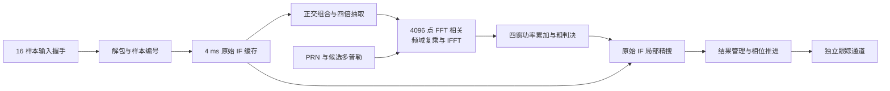
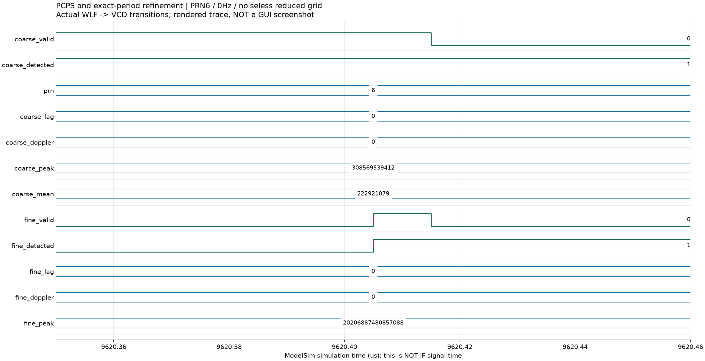
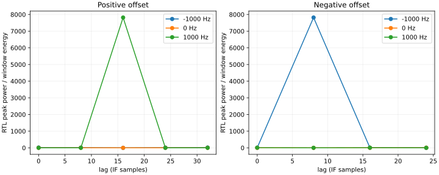

# 北斗 B1I 捕获模块设计报告

提交日期：2026 年 10 月 16 日。修订日期：2026 年 10 月 15 日。

## 1. 实验目的与设计要求

捕获是接收机建立同步的起点。本实验从量化实中频样本中搜索卫星 PRN、主码延迟和载波多普勒，为后续码环、载波环提供初始状态。设计采用 **PCPS/FFT 粗搜索与原始 IF 局部精搜索相结合**的结构，在教师公开 IF 场景中完成 PRN8、11、13、21 的自主捕获，并将结果移交给四个独立跟踪通道。

除相关峰搜索外，模块还需要完成四项工作：保存具有明确参考时刻的输入窗口；通过非相干积分提高检测稳定性；在输出反压期间保持结果；将历史窗口上的码、载波状态推进到实际跟踪启动样本。上述功能共同构成捕获到跟踪的完整数据通路。

表 1　输入条件与当前实现参数。

| 项目 | 参数与实现 |
|---|---|
| 采样率与实中频 | $F_s=16.368\ \mathrm{MHz}$，$f_{IF}=4.092\ \mathrm{MHz}=F_s/4$ |
| 主码 | 2.046 Mcps，2046 chip/周期，1 ms 对应 16368 样本 |
| 输入量化 | 2 bit 编码映射为 −3、−1、+1、+3，内部使用有符号 3 bit |
| 输入握手 | 32 bit 总线每次传递 16 样本，最低 2 bit 对应最早样本 |
| 粗搜索 | PRN6～37；多普勒约 ±10 kHz、间隔 500 Hz；4096 点 FFT |
| 精搜索 | 粗延迟附近 ±16 sample、步长 1 sample；粗频偏附近 ±250 Hz、步长 50 Hz |
| 积分与缓存 | 4 个 1 ms 窗非相干积累，保存 65472 个原始 IF 样本 |
| 接收机配置 | 默认 4 个跟踪槽，共享捕获计算单元 |

输入打包和输出记录遵循教师 [README](../student_release/student_release/README.md)、[输入契约](../student_release/student_release/input/input_contract.json)及 [RECORD_FORMAT](../student_release/student_release/submission/RECORD_FORMAT.md)。算法与主码参数参考[指导书 V1.7](../EDA_CONTEXT_COMPRESSED/集成电路EDA实验指导书_V1.7(1).pdf)第 3、7 章及 [B1I ICD 2.1](../EDA_CONTEXT_COMPRESSED/北斗_B1I_B2I_ICD_2.1版_中文版.pdf)§4.3。

## 2. 设计思路与方案选择

### 2.1 从串行相关演进到两级搜索

早期设计复用 PRN 发生器、NCO、混频器和相关器，对每个“码延迟—频率”组合重放 1 ms 样本。串行结构便于逐格检查乘加、积分和门限，四个用例共 31 格点完成了初始功能验证。随着搜索范围扩大，逐个码延迟重复积分成为主要计算开销，因此当前方案在每个频点用 FFT 一次求出所有循环延迟的相关值。

PCPS（并行码相位搜索）先利用 $f_{IF}=F_s/4$ 的关系完成正交组合与四倍抽取。每毫秒得到 4092 个复样本，补零到 4096 点后使用基 2 FFT。该结构把主要运算转化为可复用的蝶形和频域复乘，适合串行 FFT 硬件实现。

粗搜负责覆盖整个主码周期和多普勒范围；精搜负责提高估计精度。4096 点补零循环相关的周期与实际 16368 样本主码周期略有差异，粗频率网格也有量化间隔。精搜返回原始 IF，在正确主码周期上对小范围候选直接相关，同时修正这两类误差。

图 1　两级捕获结构。主要 RTL 为 [acquisition_pcps](../student_release/student_release/rtl/acquisition_pcps.sv)、[fft4096_serial](../student_release/student_release/rtl/fft4096_serial.sv)、[acquisition_refine](../student_release/student_release/rtl/acquisition_refine.sv)及 [receiver_multichannel](../student_release/student_release/rtl/receiver_multichannel.sv)。

### 2.2 共享计算与通道分配

冷启动时，接收机先取得 4 ms 历史窗口，再顺序搜索 PRN 和频率。公共输入暂停期间，捕获模块反复读取缓存；完成分配与相位预置后，各跟踪槽统一进入运行状态。这样可以复用一套捕获计算资源，并保持各槽输入样本的公共时间基准。

多通道实现进一步加入后台抓窗和搜索：捕获计算读取独占历史缓存，已锁定通道继续处理公共样本。卫星管理器依据 PRN、任务编号、代次及槽状态接纳结果，拒绝重复分配；失锁槽释放后可重新搜索。该调度结构使“发现新星”和“维持已有跟踪”能够协同工作，详见 [F 阶段多通道设计](F_MULTICHANNEL_DESIGN.md)。

## 3. 核心算法与 RTL 实现

### 3.1 PCPS 粗相关与非相干积累

设原始实样本为 $x[n]$，四样本正交组合为

$$
z[m]=(x[4m]-x[4m+2])+j(-x[4m+1]+x[4m+3]).
$$

这一组合利用中频每样本转过四分之一周的特点，得到下变频后的 I/Q，并将采样率降至 4.092 MHz。本地码按每 chip 两点形成参考序列。对第 $w$ 个窗口和候选频偏 $f$，相关及非相干功率写为

$$
r_w[\ell,f]\propto\operatorname{IFFT}\!\left\{
\operatorname{FFT}\!\left(z_w[m]e^{-j2\pi f(4m)/F_s}\right)
\operatorname{FFT}(c[m])^*\right\},\qquad
P[\ell,f]=\sum_{w=0}^{3}|r_w[\ell,f]|^2.
$$

式中的比例系数对应 FFT/IFFT 的逐级缩放。四窗分别相关后累加功率，可保留不同窗口的相关能量，避免窗间数据或 NH 符号改变造成复数相关和相互抵消。

搜索遍历频率网格并保存全局最大峰。设获胜频点各延迟功率之和为 $S$，粗判决采用

$$
4096P_{max}>8S,\qquad S=\sum_{\ell=0}^{4095}P[\ell,f].
$$

这相当于峰均比大于 8，RTL 通过乘法比较避免除法截断；诊断输出的均值另取 `S>>12`。FFT 索引先映射为有符号延迟：前半区保持正值、后半区减 4096，再乘 4 并按 16368 取模，作为精搜中心。

### 3.2 原始 IF 局部精搜索与判决

精搜默认包含 33 个码延迟、11 个频率，共 363 格点。每格重放同一组 65472 样本，以原始采样率产生本地码和载波。前端设置 `ALIGN_FIRST_WINDOW=0`，使四个积分窗口与捕获缓存边界一致：

$$
I_w=\sum_n x[n]\cos\theta[n]c[n-lag],\quad
Q_w=-\sum_n x[n]\sin\theta[n]c[n-lag],\quad
P_f=\sum_{w=0}^{3}(I_w^2+Q_w^2).
$$

精搜选择最大功率格点，并以 $P_{f,max}>4E_f$ 复核，其中 $E_f$ 为四窗混频样本的逐点 I/Q 能量和。粗、精两级判决通过后，管理器将精修 PRN、码延迟、频偏和参考时刻送入槽分配逻辑。

频偏以有符号 32 bit 控制字 $D$ 表示，其物理频率为 $DF_s/2^{32}$。粗搜端点为 ±2624000，步长 131200；精搜步长 13120，分别对应约 ±10 kHz、500 Hz 和 50 Hz。采用控制字统一搜索和跟踪的频率表示，移交时可直接复用。

### 3.3 定点格式与状态控制

表 2　主要存储和运算位宽。

| 数据 | 格式及实现 |
|---|---|
| 原始 IF 缓存 | 有符号 3 bit，65472 项 |
| 抽取 I/Q | 两组有符号 16 bit 数组，各 16368 项 |
| FFT 数据、旋转因子 | 复数据有符号 32 bit；sin/cos 为 Q30；乘法中间量 64 bit |
| FFT 蝶形 | 12 级，每级算术右移 1；每拍一个蝶形，共 24576 蝶形拍 |
| 输入幅度缩放 | 信号乘 2048，参考码幅度 ±65536 |
| 精搜混频与积分 | 混频 14 bit、积分和 28 bit，均有符号 |
| 平方与功率 | 56 bit 平方，扩位后以无符号 64 bit 累加 |
| 输出元数据 | lag 为 14 bit，FCW 为有符号 32 bit，窗口 ref 为 64 bit |

FFT 乘法扩位后算术移位，并显式转回 32 bit。初版幅度缩放较小，在逐级归一化时损失了弱分量；将信号幅度系数调整为 2048 后，整数模型逐点核对和浮点误差检查均通过。验证同时保留位精确模型与浮点模型：前者检查实际定点运算，后者评价缩放和截断带来的数值误差。

粗搜状态机依次完成抓窗、码 FFT、候选频率信号 FFT、频域乘积、IFFT、功率评价和结果输出；精搜通过 INIT、PRIME、REPLAY、EVALUATE、RESULT 重用相关前端。输出采用 ready/valid 握手，`valid&&!ready` 时保存整组结果。顶层 type5 记录包含捕获参考、精修参数及周期计数，便于核查搜索过程。

### 3.4 捕获参考时刻与跟踪移交

捕获估计对应历史窗口首样本 $n_r$，跟踪实际从样本 $n_e$ 开始。令 $\Delta n=n_e-n_r$，码相位模数为 $M=2046\times2^{32}$，初始化计算为

$$
Q_e=((16368-lag)\bmod16368)2^{29}
+\Delta n\left(2^{29}+\operatorname{trunc}(D/763)\right).
$$

其中 $2^{29}$ 对应每样本 1/8 chip，763 为 B1I 射频与码率之比，用于多普勒码速辅助。$Q_e$ 除以 $M$ 的商和余数分别给出整码周期数与周期内相位；载波从参考零相位推进 $\Delta n(2^{30}+D)$，取低 32 bit 作为启动相位，剩余相差由跟踪环拉入。

冷启动以实际已处理样本为启动参考；后台分配预约 `processed_samples+4096`，为 PRN 预置留出时间，新槽到预约样本才开始接纳。相位推进始终依据真实样本编号，因此输入暂停和计算等待自然得到一致处理。[接收机集成时间契约](RECEIVER_INTEGRATION.md)给出了该接口与跟踪、导航记录的对应关系。

## 4. 仿真环境、测试条件与结果分析

### 4.1 验证方法与数值结果

模块及整机验证主要采用 Windows、WSL2 Ubuntu、Verilator 5.032、g++ 15.2.0 和 Python。串行相关用独立浮点相关器评分；PCPS 同时与整数、浮点模型核对。教师公开场景包含 100 s、40 dB-Hz、六颗 D1 卫星的 2 bit 实 IF，接收机使用四槽配置。

表 3　模块数值核对与分版本整机实验结果。

| 测试版本与输入 | 实测结果 | 证据 |
|---|---|---|
| A～D，四个串行用例、31 格点 | 全部 PASS；归一化功率最大误差 0.0018028901，容限 0.02 | [运行日志](../reports/local/tb_acquisition_serial.run.log)、[浮点评分](../reports/local/acquisition_float_score.log) |
| E，公开 IF 前 4 ms、32 PRN 完整粗搜 | 345073499 拍，墙钟 102.305 s，产生 5 个粗候选 | [PCPS 日志](../reports/e_stage/tb_pcps_real.run.log) |
| E，PCPS 定点核对 | 首格 4096 点功率及 32 个全局候选与整数模型精确一致；峰均比最大相对误差 1.424%，容限 3% | [评分日志](../reports/e_stage/pcps_fixed_score.log) |
| E，公开 100 s 整机 | 自主捕获四星，后续跟踪和导航恢复通过教师 self_check | [E 阶段报告](../reports/e_stage/final/FINAL_REPORT.md) |
| F，多通道实现公开 20 s | 功能 PASS；80100 条非 end 记录与 E 同时段前缀一致，比较时排除捕获周期字段 | [F 阶段报告](../reports/f_stage/FINAL_REPORT.md) |
| G，公开 52 s | 执行 16 个 PRN 任务后分配四星；208428 条非 end 记录保持相应前缀一致性 | [G 阶段报告](../reports/g_stage/FINAL_REPORT.md) |

粗搜的 5 个候选包含 PRN28，后续精搜和管理过程最终选择了 PRN8、11、13、21。两级结构在此将宽范围候选生成与细致复核分开，四组结果随后支撑了持续跟踪和电文恢复。

表 4　G 版本 52 s 运行中的实际捕获输出，数据取自 [real52 metrics](../reports/g_stage/real52/metrics.json)。四组窗口 ref 均为 0，输出时累计接纳 65488 样本。

| PRN | 码延迟/sample | 频偏控制字 | 频偏/Hz | 粗算拍数 | 精修及复核拍数 | 首次输出全局拍 |
|---:|---:|---:|---:|---:|---:|---:|
| 8 | 12603 | 131200 | 500.000 | 10781374 | 23941051 | 56354752 |
| 11 | 2024 | −747840 | −2849.997 | 10781374 | 24421124 | 113120002 |
| 13 | 1563 | 183680 | 699.999 | 10781374 | 24441991 | 159124744 |
| 21 | 6099 | −406720 | −1549.999 | 10781374 | 24236170 | 269611915 |

单星粗算加精修约需 3472～3522 万拍，首次输出全局拍还包含抓窗和前序任务等待。捕获复核到输出均为 2 拍，说明结果经过固定流水进入记录接口。这里分别保留样本参考和计算拍数，可以同时分析信号状态与硬件计算开销。

### 4.2 两级结果波形与串行相关图

图 2 使用 ModelSim SE-64 10.5 运行当前 RTL 的 `tb_p02_probe`：输入为无噪声 PRN6、0 Hz、4 ms IF，粗搜配置为一颗 PRN、一个频点，精搜为 ±4 sample、0 Hz。测试接纳 65472 样本，接纳任务至复核为 962024 拍，自动判定 `P02_RTL_TIMING_PROBE_PASS`，退出码 0。[原始日志](../reports/local/report_refresh_2026-10-14/modelsim_tb_p02_probe.log)

图 2　真实 WLF 导出 VCD 后绘制的结果时序，横轴为 100 MHz 测试平台的逻辑时间。局部窗口显示粗候选保持期间精搜完成：`fine_detected` 置位，`fine_valid` 给出有效结果，PRN6 的 lag 与频偏均为 0；结果握手后 valid 撤销。粗峰值 308569539412、均值 222921079，对应明显的相关峰；精搜峰值为 20206887480857088。两级功率使用各自的缩放，分别参与本级判决。该时序展示了候选保持、精搜确认和握手结束的完整连接过程。

图 3　早期串行搜索的实际格点功率，数据来自 `acquisition_cells.csv`。正频偏用例在 lag16、+1000 Hz 附近取得目标峰，负频偏用例在 lag8、−1000 Hz 取得目标峰，说明本地码延迟方向和载波补偿符号设置一致。配合 31 格点的独立功率核对，这一实验为后续复用混频、相关与精搜前端建立了基础。图像来源、绘图区间及原始文件哈希统一保存在[图像证据清单](report_assets/waveform_provenance.json)。

### 4.3 噪声与 NH 边界分析

G 阶段进一步采用自生成 IF 检查搜索边界。每档包含 6 个有目标、2 个无目标的 4 ms 用例，搜索 PRN6/7、41 个粗频点及完整 33×11 精网格；两档使用相同种子集合。码延迟覆盖 0、1、8191、8192、16366、16367 sample，频偏覆盖 −10000、+10000、−9750、+9750、−250、+250 Hz，NH 相位涉及 0、1、7、19。成功条件为 PRN 正确、循环码延迟误差不超过 1 sample、频率误差不超过 100 Hz。

表 5　噪声与 NH 联合边界测试结果。

| 输入 C/N0 | 满足成功条件 | 无目标误检 | 结果 |
|---:|---:|---:|---|
| 40 dB-Hz | 1/6 | 0/2 | 边界测试未通过 |
| 50 dB-Hz | 5/6 | 0/2 | 边界测试未通过 |

来源：[40 dB-Hz 结果](../reports/g_stage/acquisition/metrics.json)、[50 dB-Hz 结果](../reports/g_stage/acquisition_cn50/metrics.json)。这组测试显示，提高信号强度后成功数由 1 个增加到 5 个。50 dB-Hz 的剩余失败点为真值 −9750 Hz、NH 相位 7，估计约 −9950 Hz；[独立浮点扫频](../reports/g_stage/acquisition_cn50/nh_frequency_objective_diagnostic.json)在同一 IF、真值码相位下也于 −9950 Hz 取得最大值。该现象将问题指向固定 1 ms 窗内 NH 翻转对相关目标的影响，解释了四窗非相干积累与窗内符号变化之间的区别。

## 5. 实验结论

本实验完成了从串行相关到 PCPS 粗搜、原始 IF 精搜的两级捕获设计。FFT 同时搜索全部码延迟，局部精搜恢复原始主码周期和细频率分辨率，整数与浮点模型共同验证了定点运算。真实公开场景中，模块输出四颗卫星的码延迟与频偏，经样本参考推进后进入闭环跟踪；E 的 100 s、F 的 20 s 和 G 的 52 s 运行分别提供了对应版本的系统实验结果。

设计迭代的关键在于同时处理数值精度和时间语义：幅度缩放改善逐级 FFT 截断，原始 IF 复核修正粗搜索格点误差，真实样本编号使后台搜索与通道启动保持相位一致。这些实现使捕获结果能够直接成为后续跟踪、同步和导航恢复的有效初值。

当前需要继续改善的主要是低信号强度及 NH 窗内翻转条件下的检测稳定性；上述边界测试保留了漏检和约 200 Hz 频偏偏置。后续可围绕积分窗口与 NH 变化的关系优化判决，并增加独立随机样本以评价检出率和误检率。
