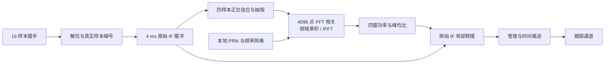

# 北斗 B1I 捕获模块设计报告

提交日期：2026 年 10 月 16 日。修订日期：2026 年 10 月 14 日。

本报告依据已核对的 GitHub main `7dfa40b`、当前学生 RTL 和实际日志。接收机当前采用 **PCPS/FFT 粗搜索＋原始 IF 局部精搜索**，已在教师公开 IF 中自主捕获 PRN8、11、13、21。E 的完整 100 秒结果是历史功能证据；F20 秒和 G52 秒为后续版本验证，不能写成最新代码重新完成 100 秒测试。G 捕获边界子集仍存在 FAIL，正式 P01～P03 尚未完成验收。

## 1. 实验目的与设计要求

从未知 PRN、码起点和载波频偏的量化实中频中搜索卫星，输出带参考时刻的码延迟与多普勒初值，并交给跟踪通道。设计需要同时保证相关运算、判决、结果保持和时间对齐。

表 1　教师输入与当前搜索参数。输入及记录以 [README](../student_release/student_release/README.md)、[input_contract](../student_release/student_release/input/input_contract.json)、[RECORD_FORMAT](../student_release/student_release/submission/RECORD_FORMAT.md) 为准。

| 项目 | 当前配置 |
|---|---|
| 采样率／中频 | $F_s=16.368\ \mathrm{MHz}$；$f_{IF}=4.092\ \mathrm{MHz}=F_s/4$ |
| 主码 | PRN6～37，2.046 Mcps，2046 chip／1 ms，每周期 16368 样本 |
| 输入 | 2 bit 映射 −3／−1／+1／+3，内部 signed 3 bit |
| 流接口 | 每次握手 16 样本，总线最低 2 bit 最早；解包后引用逐点增加 |
| 粗搜索 | 默认 PRN6～37，约 ±10 kHz／500 Hz，4096 点 FFT 延迟搜索 |
| 精搜索 | 粗延迟 ±16 sample／1 sample，粗频偏 ±250 Hz／50 Hz |
| 积分 | 4×1 ms 非相干功率和，原始历史窗 65472 样本 |
| 通道 | 默认四槽；支持 1／2／4／12 独立槽，十二星完整 IF 未验收 |

教师公开文件为静态六星、40 dB-Hz、100 秒开发场景，传播时延和多普勒仍随卫星运动变化。默认四槽成功不代表六星全检出。教师纯仿真接口不要求学生实现 SRAM 控制器；公开文件没有独立码／频／位置真值，不能代替全部正式性能输入。

## 2. 设计思路与方案选择

### 2.1 从串行相关到两级搜索

A～D 的 `acquisition_serial.sv` 复用已有 PRN、NCO 和相关前端，逐个重放码延迟×频率格点，完成四个高信噪比用例、31 格点的实际验证。它适合逐点核查，但全范围反复积分成本高，单窗也没有非相干积累。保留该实现作为历史设计起点及旧单星回归，当前默认路径采用 FFT 同时计算每个频点上的全部延迟。

PCPS 利用 IF＝Fs／4，以四样本正交组合下变频、四倍抽取；每个 1 ms 窗得到 4092 复样本，补零到 4096 点使用 radix-2 FFT。补零后的循环周期与真实 B1I 主码不同，所以粗延迟只作候选；精搜回到原始 IF 和精确 16368 样本周期，修正补零失配及频率格点误差。

图 1　当前结构。实现：[acquisition_pcps](../student_release/student_release/rtl/acquisition_pcps.sv)、[acquisition_refine](../student_release/student_release/rtl/acquisition_refine.sv)、[receiver_multichannel](../student_release/student_release/rtl/receiver_multichannel.sv)。

### 2.2 共享捕获与独立跟踪

冷启动抓取历史窗后暂停公共样本消费，顺序搜索 PRN／频率；槽分配完成或搜索结束后统一 RUN。F 新增后台抓窗和搜索：FFT／精搜只读独占历史缓存，健康通道继续处理公共样本；满载时延后新搜索，不抢健康星。管理拒绝重复 PRN、旧任务和不合格捕获窗，并负责释放与重搜。这些是功能调度；持续实时能力还需要有限缓存及目标时钟证据。[F 多通道设计](F_MULTICHANNEL_DESIGN.md)

## 3. 核心算法与 RTL 实现

### 3.1 粗相关、非相干积累与判决

原始样本 $x[n]$ 的四样本正交组合为

$$
z[m]=(x[4m]-x[4m+2])+j(-x[4m+1]+x[4m+3]).
$$

擦除候选多普勒、补零至 $L=4096$ 后，各窗相关及四窗功率为

$$
r_w[\ell,f]\propto\operatorname{IFFT}\{\operatorname{FFT}(z_w[m]e^{-j2\pi f(4m)/F_s})\operatorname{FFT}(c[m])^*\},\qquad
P[\ell,f]=\sum_{w=0}^{3}|r_w[\ell,f]|^2.
$$

比例符号表示 RTL FFT/IFFT 的逐级归一化。选全频率网格最大峰，令获胜频点 $S=\sum_{\ell=0}^{4095}P[\ell,f]$，实际粗判决为 $4096P_{max}>8S$。诊断均值为 `S>>12`，判决直接使用未除法的 S。门限 8 是工程 baseline，不是教师门限或已校准的虚警工作点。

非相干功率和减少不同窗的未知符号互相抵消，但不能消除窗内 NH 翻转损失。FFT 索引先解释为有符号循环延迟：$s(\ell)=\ell$（$\ell<2048$），否则 $s(\ell)=\ell-4096$，粗 lag 为 $(4s(\ell))\bmod16368$；需经过原周期精搜，不能直接当作真实主码相位。

### 3.2 局部精搜索

默认 33×11＝363 格点，每格完整重放 65472 原始 IF 样本。前端 `ALIGN_FIRST_WINDOW=0`，以捕获缓存边界积分四个 1 ms 窗：

$$
I_w=\sum_n x[n]\cos\theta[n]c[n-lag],\quad Q_w=-\sum_n x[n]\sin\theta[n]c[n-lag],\quad
P_f=\sum_{w=0}^{3}(I_w^2+Q_w^2).
$$

精判决为 $P_{f,max}>4E_f$，其中 $E_f$ 是同四窗混频后逐样本 $i^2+q^2$ 累计。两级判决均成立才考虑分配；精判决只是能量复核，后续 `locked` 必须由真实跟踪建立。

频偏控制字 D 的 Hz 值为 $DF_s/2^{32}$；标称 IF 字 `0x40000000`。粗搜端点 ±2624000、步长131200；精搜步长13120，对应约±10 kHz／500 Hz／50 Hz，有控制字量化误差。

### 3.3 位宽、状态机与结果

表 2　当前定点实现。无任意输入下的全范围溢出证明，不把已测覆盖外推为通用保证。

| 量 | 格式与处理 |
|---|---|
| 原始捕获缓存 | signed 3 bit ×65472，保留量化值 |
| 抽取 I/Q | 两个 signed 16 bit 数组，各16368项 |
| FFT 数据／旋转常数 | signed 32 bit 复数据／Q30 sin-cos；signed 64 bit 乘法 |
| FFT 缩放 | 12级，每级算术右移1；每拍一个蝶形，每次24576蝶形拍 |
| 幅值 | 信号混频乘2048；参考码±65536，减少归一化截断 |
| 精搜混频／和／功率 | signed14／signed28；平方56，扩位为 unsigned64 功率 |
| 延迟／频偏／ref | 14 bit sample／signed32 FCW／64 bit 窗首样本 |
| 周期 | 32 bit；模块计数与顶层type5全局计数分别解释 |

FFT 乘法扩位、算术移位后显式转回32 bit，无饱和器；精搜平方完整保留后扩位相加。粗搜状态包含抓窗、码FFT、逐频信号FFT、乘积、IFFT、功率评价、判决及RESULT；精搜为INIT→PRIME→REPLAY→EVALUATE→RESULT。结果 `valid&&!ready` 时保持，握手后推进。

type5 保存 PRN、捕获 ref、精修 lag／FCW／峰值。顶层 `acquisition_cycles` 不是单PRN执行时间，G probe 另记排队、粗算、精修复核和首次输出。

### 3.4 时间参考与跟踪移交

设捕获窗首 $n_r$、实际首跟踪样本 $n_e$，$\Delta n=n_e-n_r$，码模数 $M=2046\times2^{32}$。当前初值为

$$
Q_e=((16368-lag)\bmod16368)2^{29}+\Delta n\left(2^{29}+\operatorname{trunc}(D/763)\right).
$$

码相位取 $Q_e\bmod M$，整周期取商；763为B1I RF／码率。载波参考零相位推进 $\Delta n(2^{30}+D)$，低32 bit回绕，余相由载波环拉入。冷启动以已处理样本为生效参考；后台预约 `processed_samples+4096`，完成预置后到预约点才接纳样本。计算拍数和墙钟不进入样本差，不能用计算完成时间覆盖捕获 ref。[集成时间契约](RECEIVER_INTEGRATION.md)

## 4. 仿真环境、测试条件与结果分析

### 4.1 模块与公开 IF

主证据环境为 Windows＋WSL2 Ubuntu／Verilator5.032／g++15.2.0／Python。源、ROM和driver哈希随运行保存。本次只加ModelSim10.5轻量取证，不重跑20／52／100秒整机；真值仅激励和评分，不送DUT。

表 3　实际验证及版本范围。

| 测试 | 实测结果 | 证据 |
|---|---|---|
| A～D串行四用例／31格点 | PASS，独立浮点最大归一化功率误差0.0018028901＜0.02 | [run](../reports/local/tb_acquisition_serial.run.log)、[score](../reports/local/acquisition_float_score.log)；高信噪比缩网格 |
| E公开4ms完整32PRN粗搜 | 345073499拍／102.305s墙钟，5粗候选 | [PCPS log](../reports/e_stage/tb_pcps_real.run.log)；候选不等于有效星 |
| E整数／浮点核对 | 4096首格功率和32全局候选精确匹配；峰均比相对误差最大1.424%＜3% | [fixed score](../reports/e_stage/pcps_fixed_score.log) |
| E历史公开100s | 四星自主捕获／跟踪／导航，教师self_check退出0 | [E报告](../reports/e_stage/final/FINAL_REPORT.md) |
| F新实现公开20s | 功能PASS，80100条非end与E前缀一致，排除捕获周期字段 | [F报告](../reports/f_stage/FINAL_REPORT.md)；未重复100s |
| G公开52s | 16PRN任务／4可用结果，208428非end与E前缀一致，排除周期字段 | [metrics](../reports/g_stage/real52/metrics.json)、[G报告](../reports/g_stage/FINAL_REPORT.md)；正式性能PARTIAL |

表 4　G52真实精修输出。ref均0，输出时已接纳样本数均65488，约4ms信号时间。

| PRN | lag／sample | FCW | Hz | 粗算拍 | 精修复核拍 | 首次输出拍 |
|---:|---:|---:|---:|---:|---:|---:|
| 8 | 12603 | 131200 | 500.000 | 10781374 | 23941051 | 56354752 |
| 11 | 2024 | −747840 | −2849.997 | 10781374 | 24421124 | 113120002 |
| 13 | 1563 | 183680 | 699.999 | 10781374 | 24441991 | 159124744 |
| 21 | 6099 | −406720 | −1549.999 | 10781374 | 24236170 | 269611915 |

首次输出含共享抓窗和前序任务等待，复核至输出均2拍。单星粗算＋精修约3472～3522万拍，逻辑clk未定，不能写成已达成实时性能。公开码／频真值缺失，正确性由自主输出、独立数值核对及后续跟踪／导航一致性支持。

### 4.2 G边界失败

每档6有目标＋2目标缺失、独立seed、各4ms；候选PRN6／7，41粗频点及33×11精网格。六联合点测试lag0／1／8191／8192／16366／16367，频−10000／+10000／−9750／+9750／−250／+250Hz，NH涉及0／1／7／19。成功预设为身份正确、循环lag误差≤1sample、频误≤100Hz。

| C/N0 dB-Hz | 真值成功 | 缺目标虚警 | 检出率Wilson95%区间 | 分类 |
|---:|---:|---:|---|---|
| 40 | 1／6 | 0／2 | 3.005%～56.350% | 已执行子集FAIL／整体PARTIAL |
| 50 | 5／6 | 0／2 | 43.650%～96.995% | 已执行子集FAIL／整体PARTIAL |

来源：[40 metrics](../reports/g_stage/acquisition/metrics.json)、[50 metrics](../reports/g_stage/acquisition_cn50/metrics.json)及各scenarios／原始结果。退出0表示采集和评分完成，不表示性能PASS；两档复用相同seed集合，不合并为16独立重复。0／2虚警不能证明正式≤1%工作点。

50档case2真值−9750Hz／NH7，估计约−9950Hz。同一IF、真值码相位的[独立浮点扫频](../reports/g_stage/acquisition_cn50/nh_frequency_objective_diagnostic.json)也在−9950Hz最大，支持固定1ms积分目标受NH边界影响，未证明RTL算术错误。未调容限或门限掩盖失败。正式全覆盖及每档100有＋100缺／10s观察窗缺合格输入。

### 4.3 真实波形与历史曲线

图 2　由ModelSim SE-64 10.5实际WLF导出VCD绘制的局部时序图，**不是GUI截图**。当前RTL的 `tb_p02_probe` 中，粗候选保持期间精搜完成，输出 `fine_valid/fine_detected`、lag0／FCW0，随后结果握手撤销valid。无噪声PRN6／0Hz，4ms IF；只搜一PRN／一频点，精搜±4sample／0Hz。实际65472样本，任务接纳到复核962024拍，`P02_RTL_TIMING_PROBE_PASS`／退出0。横轴为100MHz TB逻辑时间，不是IF信号时间；它证明两级连接，不证明全网格／弱信号性能。WLF中的枚举状态导出为VCD未知编码，图中不显示或臆造状态值。[本次日志](../reports/local/report_refresh_2026-10-14/modelsim_tb_p02_probe.log)

图 3　早期实际 `acquisition_cells.csv` 曲线，保留为方案演进依据，不是PCPS性能图。图片来源、源/WLF哈希及绘图范围见[图像证据清单](report_assets/waveform_provenance.json)。

本次曾打开并观察ModelSim真实WLF，网络中断后Computer Use运行时两次报“failed to write kernel assets／系统找不到指定的路径（os error 3）”，重置后仍失败，未取得可归档GUI截图。因此采用真实VCD时序图、已有SVG和原始结果表；未修复软件安装或许可证，也未伪造截图。

## 5. 问题修复、结论及当前限制

FFT初版缩放过小造成归一化截断和噪声底偏置，修为上述幅值并重新逐点核对。弱峰浮点argmax不稳定，改用完整整数golden核候选／频偏／功率／均值／判决，另保留浮点误差检查；失败日志保留，门限不放宽。

两级捕获已有公开场景四星功能及模块数值、移交和后续前缀一致性证据。G联合边界子集未全部通过，正式统计和全覆盖尚未验收；默认四槽不代表六星全检出或十二星验收。输入反压允许暂停，持续实时未证明。未执行ASIC综合、布局布线或物理验证，不报告面积、功耗或芯片时序。

规范：[指导书V1.7](../EDA_CONTEXT_COMPRESSED/集成电路EDA实验指导书_V1.7(1).pdf)第3／7章、[B1I ICD2.1](../EDA_CONTEXT_COMPRESSED/北斗_B1I_B2I_ICD_2.1版_中文版.pdf)§4.3。历史A～D依据为[archive原目标](archive/GOAL_ABCD_2026-10-13_original.md)和reports/local。指定相对archive路径实指本仓库docs/archive，归档保持原样。
