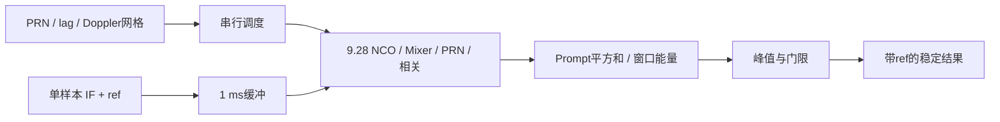

# 捕获模块设计报告（2026-10-16交付稿）

2026-10-13已实现并实际运行一个单PRN串行搜索模块，复用9.28 PRN/Code NCO/Carrier/EPL/frontend，不更改其算法。当前证据为4个高SNR静态用例、31个格点；全码周期/±10 kHz是可配置设计覆盖，尚未全范围实跑。教师场景捕获和移交闭环尚未集成，不声明完整捕获验收。

## 规格、方案与框图

Fs=16.368 MHz、IF=4.092 MHz、码率2.046 Mcps、2046 chip。固定捕获窗口16368点（1 ms），输入2 bit重构为signed 3 bit。选择串行码延迟×频率搜索，复用已验证相关前端，避免新增FFT/多引擎和存储重排。代价是全搜索较慢，不能据此声称达到冷启动时间指标。

状态：IDLE→CAPTURE→INIT→PRIME→REPLAY→EVALUATE；有下一格点则回INIT，否则RESULT，结果握手后IDLE。每个候选先初始化PRN/NCO，等预置结束再重放完整16368点。复用frontend的`ALIGN_FIRST_WINDOW=0`以对固定捕获窗口积分；不会因为候选初相而丢弃窗首样本。

## 端口和时间语义

实现：`student_release/student_release/rtl/acquisition_serial.sv`。request_valid/ready接纳PRN6–37、lag_first/last/step（单位真实IF样本）和signed Doppler控制字first/last/step；任务开始后锁存配置。合法条件：0≤lag_first≤lag_last<16368，lag_step>0，Doppler first≤last且step>0，控制字不跨signed溢出。

sample_valid/ready接收连续逻辑样本，sample_ref取第一个接纳点作为窗口参考；空拍不增加计数。调用方须提供连续引用。采满后停止接纳，反复重放不推进公共输入时间。RESULT保持detected/PRN/lag/Doppler/peak/ref/cycles直到result_ready。

lag是输入相对本地零相PRN的延迟，单位sample。本地初始码相位为`((16368-lag) mod 16368)/8` chip；后续跟踪的初相还须推进到生效样本，不可直接使用延迟值。窗口ref不会替换成计算完成时刻。当前无task_id/取消事务，未完成全系统管理；复位可丢弃任务和在途样本。cell_valid/lag/Doppler/power/energy是逐格点调试输出，无反压。

## 数学与定点

对每个延迟τ和频偏f：I=Σx[n]cos(θ[n])c[n−τ]，Q=−Σx[n]sin(θ[n])c[n−τ]，P=I²+Q²。频率控制字`round(f·2^32/Fs)`加到标称IF字0x40000000；相位先用于当前样本，再推进。最高P作为候选峰，判决`P > 16 E`，E=Σ(i_sample²+q_sample²)，并非同样本Prompt功率。

门限16是当前最小工程调试baseline，用于高SNR单星/指定错误PRN测试；未进行全搜索虚警统计或40 dB-Hz检出率校准。未知NH在窗内翻转可能使1 ms相干和抵消，当前未加跨窗口非相干积分。因此不能用detected标志推定弱星可靠捕获。

| 量 | 位宽/格式 | 数值处理 |
|---|---|---|
| 输入缓冲 | signed 3 bit ×16368 | -3/-1/+1/+3原样保存 |
| Code相位/步长 | unsigned Q11.32 / Q1.32 | 标称步长0x20000000，2046 chip回绕 |
| Carrier相位/控制字 | 32 bit一周 | 相位自然回绕；频偏signed叠加 |
| 本振 / 混频 | 12 bit ±2047 / signed 14 bit | 10 bit最近相位地址，完整乘积 |
| Prompt和 | signed 28 bit | 16368点完整和；上界100515888 |
| 平方 / 功率 | 56 bit / unsigned 64 bit | 先保留完整平方，再扩位相加，无饱和或截短 |
| 输入能量 | 42 bit，调试/门限扩为64 bit | 相同窗口/幅值单位 |
| 延迟 / 引用 / 周期 | 14 / 64 / 32 bit | ref是首点；cycle是逻辑时钟数，不冒充秒 |

最大合法输入混频幅值3×2047=6141，16368点和上界6141×16368=100515888，小于2^27；平方和完整保留。旧模块支持signed3bit的-4测试极值，28bit同样覆盖。当前无窄化优化。

## 搜索和存储预算

完整设计配置可取0.5 chip（4 sample）步长，lag=0..16364，共4092相位；−10..+10 kHz、500 Hz步长，共41频率，总167772格点。每格16368点，样本相关次数2746092096。PRN预置最坏2046拍，保守加入INIT/PRIME、结果流水与推进，总上界约`16368+167772×(16368+2053)=3090544380`逻辑周期，不含任意输入/输出等待。按教师仿真时钟16.368 MHz换算约188.82 s，只是时钟预算，不是实际全搜索结果。31格点实际cycle见下表。

原2 bit窗口4092字节；为省实现时间采用3 bit重构缓冲49104 bit=6138字节。还有旧前端寄存器/LUT，不报告未经综合的面积、功耗或PPA。

500 Hz对应字131200，±10 kHz端点分别约±2624003。使用等字步进存在极小端点舍入误差，不能把控制字直接当Hz；最终配置应记录实际频率。完整网格/边界未实跑，尚不能作为无辅助冷启动证据。

## 实际命令与结果

根目录：`.\scripts\run_local_verilator.ps1 -Task acquisition`。WSL Verilator5.032，g++15.2.0，Python3.14.4。TB自动fatal/timeout，检查峰格点、PRN、参考100000、指定判决、格点数及5拍结果背压。生成器独立float载波与list PRN，真值只产生IF和评分。

| 用例 | 注入/搜索 | 实际结果 | 逻辑周期 |
|---|---|---|---:|
| aligned | PRN6，lag0，0Hz；3码格点 | detected1，lag0，word0 |71629|
| positive | PRN6，lag16，+1000Hz；15格点 | detected1，lag16，word262400 |292628|
| negative | PRN12，lag8，−1000Hz；12格点 | detected1，lag8，word−262400 |237383|
| wrong_prn | PRN6输入，PRN12单格点 | detected0，peak0 |34794|

实际`ACQUISITION_SERIAL_PASS cases=4 cells=31`，仿真退出0；源码/TB及完整命令在build/run log，逐格点数据在`reports/local/acquisition_cells.csv`。独立float评分31格点最大`|P_RTL−P_float|/max(P_float,E_float)=0.0018028901`，小于预设0.02容限；能量相对容限0.002通过。评分日志`reports/local/acquisition_float_score.log`。对null格点使用E归一化，避免除零。没有通过缩小错误判据来保证结果。

## 未完成与衔接

当前不满足完整指导书P02/P03统计验收：未跑全2046chip/±10k、无星多次统计、40dB-Hz弱星、NH窗内翻转、格点中点、取消、捕获移交后200ms复核。教师公共0.01s流目前仍只生成end，完整self_check实际FAIL，不含type5结果。下一步把时间用于单通道闭环与跟踪报告；捕获优化和完整冷启动后移。

来源：本地《集成电路EDA实验指导书V1.7》第3.3–3.8节（PDF31–34页）、B1I ICD的PRN基线（docs/PRN_GENERATOR.md）、教师README/input_contract/RECORD_FORMAT。公共教师文件未改。正式文档排版尚未生成Word/PDF，此Markdown是可编辑交付稿。
