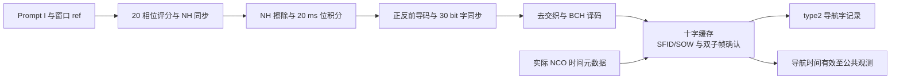

# 北斗 B1I NH、位同步与 D1 导航电文解调实验报告

提交日期：2026 年 10 月 25 日。修订日期：2026 年 10 月 15 日。

## 1. 实验目的与设计要求

本实验将跟踪通道的 1 ms Prompt 积分转换为具有导航时间的 D1 电文字。设计依次完成 NH20 同步、20 ms 位同步、前导码及 30 bit 字同步、极性恢复、去交织、BCH(15,11) 译码和子帧/SOW 检查，最终由 RTL 输出教师格式的 type2 导航记录，并为公共观测提供时间有效标志。

实验从合成 Prompt 的逐字功能验证出发，完成了与真实 IF 捕获、跟踪通道的连接。教师公开场景中，E 版本 100 s 恢复 560 字，F 多通道版本 20 s 恢复 40 字，G 版本 52 s 恢复 240 字，均经过独立逐字核对。设计重点是把位、字、子帧和导航时间组织为逐层确认的硬件状态，使数据内容、通道身份和时间参考共同进入记录接口。

表 1　同步与解调参数。

| 项目 | 参数与实现 |
|---|---|
| Prompt 输入 | 每毫秒一次，内部 I 积分为有符号 28 bit，附带窗口参考与 NCO 元数据 |
| 主码与采样率 | 2046 chip/1 ms，$F_s=16.368\ \mathrm{MHz}$ |
| NH20 | 时间顺序 00000100110101001110，每 chip 1 ms |
| 数据位 | 50 bit/s，每位 20 ms，对应 20 个 Prompt |
| 前导码 | 11100010010，同时搜索正常及反相极性 |
| 字与子帧 | 30 bit/字，10 字/子帧，6 s/子帧，SFID 为 1～5 |
| 纠错 | BCH(15,11)，$g(x)=x^4+x+1$，每码字纠正一个比特 |
| 输出 | type2：原始字、译码信息、字号、SFID、SOW、纠错数、码状态和有效标志 |

信号和电文格式参考 [B1I ICD 2.1](../EDA_CONTEXT_COMPRESSED/北斗_B1I_B2I_ICD_2.1版_中文版.pdf)§5.1.3、§5.2.1、§5.2.2，以及[指导书 V1.7](../EDA_CONTEXT_COMPRESSED/集成电路EDA实验指导书_V1.7(1).pdf)第 6、7 章；输出遵循教师 [RECORD_FORMAT](../student_release/student_release/submission/RECORD_FORMAT.md)。

## 2. 设计思路与方案选择

### 2.1 分层恢复与分层确认

NH 同步首先确定 20 ms 位的边界，再擦除 NH 并对 Prompt 软积分。字同步在恢复的数据位中同时搜索前导码和补码，解决 Costas 环的整体极性模糊。BCH 层还原信息比特；导航封装层缓存十字，检查子帧编号、周内秒和相邻子帧间隔，确认导航时间后发布完整子帧。

这种结构使各级接口清晰：NH 层处理毫秒积分，字层处理 30 bit 数据，导航层处理完整子帧和时间。软件评分读取 RTL 输出进行独立核对，硬件数据通路由实际 Prompt 驱动。

图 1　同步与导航解调结构。实现分别为 [nh20_sync](../student_release/student_release/rtl/nh20_sync.sv)、[d1_word_sync](../student_release/student_release/rtl/d1_word_sync.sv)、[navigation_d1](../student_release/student_release/rtl/navigation_d1.sv)，由 [receiver_channel](../student_release/student_release/rtl/receiver_channel.sv)连接至跟踪通道。

### 2.2 多通道状态与记录输出

每个槽独立保存 NH 相位、极性、字号、子帧、时间和待发记录，输出端仲裁各槽的 ready/valid 接口。槽分配携带 PRN、channel 和 generation；失锁时清除本槽同步和时间状态，重新分配后重新训练。输出反压期间保持已经提交的 payload，保证接收端能够完整读取同一条记录。[F 多通道设计](F_MULTICHANNEL_DESIGN.md)给出了槽复用和记录仲裁的实现。

## 3. 核心算法与 RTL 实现

### 3.1 NH20 相位搜索与位同步

NH 层并行维护 20 个候选相位。设候选 $h$ 对应的 NH 符号为 $a_h[k]\in\{-1,+1\}$，对每组完整的 20 个 Prompt 先作 NH 擦除和软积分，再累加绝对值：

$$
B_h[b]=\sum_{k\in b\text{ 的 20 个 Prompt}}a_h[k]I_P[k],\qquad
S_h=\sum_{\text{完整训练位 }b}|B_h[b]|.
$$

正确相位下，NH 擦除后的同一数据位能够同相积累；未知数据位的正负号由绝对值消除，因此训练过程可以直接使用实际电文 Prompt。`tick_mod` 随 prompt_valid 推进，训练长度为 400 个事件，前 20 个事件用于避开起始残缺位。最高得分非零且超过第二名两倍时锁定，否则重新训练。

锁定后从下一个完整位起点开始积累，20 项有符号 28 bit Prompt 扩位相加为 34 bit `bit_soft`，负值判为数据位 1，`bit_ref` 保存该位首 Prompt 的窗口参考。评分使用无符号 64 bit；整体极性由后续前导码统一恢复。该实现把 NH 相位识别与位积分合并，明确建立了毫秒 Prompt 到 20 ms 数据位的对应关系。

### 3.2 前导码、极性与 BCH 译码

11 bit 滑动寄存器搜索前导码 11100010010 及其补码。找到前导码后记录极性，将后续数据统一到正常极性并组成 30 bit 字。字 1 的前 15 bit 直接保留，后 15 bit 进入一组 BCH(15,11)；其他字按相邻交织位分离为两组 15 bit 码字，分别纠错，再拼成 22 bit 信息，存入 26 bit 输出的低位。

BCH 译码以 $g(x)=x^4+x+1$ 计算 4 bit syndrome。syndrome 为零时保留码字；非零时匹配 15 种单错 syndrome 并翻转对应位置，取修正码字的前 11 bit 作为信息。`corrected_bits` 为各组纠错数之和：字 1 为 0 或 1，其他字为 0、1 或 2，其中 2 对应两组码字各纠正一位。

接口同时输出统一极性、未经 BCH 修正的 `raw_word` 和译码后的 `information`，使原始接收内容与纠错结果可直接比较。完成第 10 字后重新搜索前导码；`word_valid` 标记一次完整字输出，`bch_valid` 给出译码检查结果。

### 3.3 十字缓存、SOW 与导航时间

`navigation_d1` 缓存完整十字。字 1 检查前导码、BCH 和 SFID1～5；字 2 将字 1 的 information[7:0] 作为高 8 bit、自身 information[21:10] 作为低 12 bit，组成 20 bit SOW，并检查其小于 604800。字 2 到达后回填字 1 的 SOW，使十条记录具有一致的子帧时间。

导航时间通过连续两个完整合法子帧确认，条件为

$$
SFID_2=SFID_1\bmod5+1,\qquad
SOW_2=(SOW_1+6)\bmod604800,\qquad
ref_2-ref_1=6F_s=98208000.
$$

这里 ref 是子帧首位窗口的内部参考。三个条件分别检查子帧顺序、导航秒连续性和实际接收样本间隔。确认后置 frame_valid、time_valid，并顺序发布第二子帧的十条记录。将单字 BCH 检查与跨子帧时间检查结合，使电文内容和时间演进相互校验。

### 3.4 时间元数据与 type2 记录

从 Prompt 到位、字的流水同时保存末 Prompt 的实际 NCO 相位、整周期和步长。每字使用最后一位的元数据推导最近本地主码结束边界，type2 的 sample_index 取该边界后首整数样本，code_chip 为 0，fraction 保留真实 NCO 余量。这样，SOW 表示导航电文的时间内容，sample_index 和码状态表示该字实际接收的本地时间，两者各有明确来源。

表 2　type2 关键字段。

| 字段 | 位宽与含义 |
|---|---|
| PRN/channel/generation | 6/4/8 bit，卫星、槽和分配代次 |
| sample_index | 64 bit，字结束附近的本地主码边界参考 |
| raw_word/information | 30/26 bit，原始字与译码信息 |
| word_number/SFID/SOW | 4/3/20 bit，字号 1～10、子帧号、周内秒 |
| corrected_bits | 2 bit，各 BCH 码字纠错数之和 |
| code_epoch/chip/fraction | 16/11/32 bit，整周期和边界处码状态 |
| 状态 | locked、NH、frame、time 和 BCH 等有效标志 |

集成时将早期的窗口首参考扩展为末积分 NCO 元数据，使 type1 和 type2 使用一致的码结束锚点；十字缓存解决了字 1 的完整 SOW 需等字 2 到达的问题。type4 在公共整秒样本、NCO 推进前保存观测状态，由 active、locked、NH、frame、time 及所需 BCH 条件共同置 measurement_valid。时间定义详见[接收机集成文档](RECEIVER_INTEGRATION.md)。

## 4. 仿真环境、测试条件与结果分析

### 4.1 合成 Prompt 的逐字功能验证

主验证环境为 WSL2 Ubuntu、Verilator 5.032 和 Python；ModelSim SE-64 10.5 用于模块时序取证。合成激励由独立 Python 多项式长除法生成 BCH，Prompt 幅值为 ±100000，先发送 40 个恒定位用于训练和等待，再发送三个含有效信息和可控单错的字。三个用例分别为 NH 相位 0 正常极性、相位 7 反相、相位 19 正常极性。

表 3　同步、译码与导航封装的分层测试。

| 测试 | 实测结果 | 证据 |
|---|---|---|
| A～D，三种 NH/极性组合 | 输出位数 111/110/110；各恢复三字，共九字；数据、纠错数和时间逐事件匹配 | [运行日志](../reports/local/tb_nh_d1.run.log)、[字记录](../reports/local/nh_d1_words.csv) |
| 教师 decode_word 独立核对 | 九字 raw、information 和纠错数全部一致 | [软件核对日志](../reports/local/nh_d1_software_diagnostic.log) |
| 实际跟踪 Prompt 接口 | 输入 999 窗，识别 NH 相位 1，恢复 29 个恒定位 | [连接测试](../reports/local/tb_nh_actual_prompt.run.log) |
| E，双子帧导航封装 | NH7 正常、NH19 反相；两例共 20 条 type2，时间锚、背压保持和失锁复位均 PASS | [导航日志](../reports/e_stage/final_modules/tb_navigation_d1.run.log) |
| F，十二路合成 Prompt | 120 字；NH0/7/19、两极性、槽身份、代次、背压和失锁测试 PASS | [多路日志](../reports/f_stage/f3_current/tb_navigation_bank.run.log) |
| ModelSim 模块重复运行 | 九字及双子帧测试均自动 PASS，退出码 0 | [九字取证](../reports/local/report_refresh_2026-10-14/modelsim_nh_d1.log)、[导航取证](../reports/local/report_refresh_2026-10-14/modelsim_tb_navigation_d1.log) |

表 4　合成实验中三种纠错情况的代表字，均为十六进制。

| 字号 | raw_word | information | corrected_bits |
|---:|---|---|---:|
| 1 | 3890b45a | 3890b45 | 0 |
| 2 | 1666677c | 00aaeab | 1 |
| 3 | 0fac034e | 01f0b21 | 2 |

三种 NH 相位和正反极性均恢复相同的信息，验证了 NH 擦除、极性归一化和去交织的配合；0、1、2 的纠错数覆盖了无错、一组单错和两组各单错的译码路径。

### 4.2 NH、字输出与子帧确认波形

下列时序图由上述 ModelSim 真实 WLF 导出 VCD 绘制。模块测试压缩了 Prompt 事件间隔，横轴为测试平台逻辑时间；位长仍按 20 个有效 Prompt 定义。原始命令、运行状态及图像来源见[图像证据清单](report_assets/waveform_provenance.json)。

图 2　NH 相位 0、正常极性用例的局部时序。`nh_locked` 保持有效，`bit_valid` 随完整位积分产生脉冲，字层每收齐 30 bit 给出 `word_valid`。图中 raw_word 从 `3890b45a` 进入 `1666677c`，对应 information 从 `3890b45` 变为 `00aaeab`，纠错数从 0 变为 1，BCH 检查有效。原始字、译码信息和纠错标志在同一输出事件更新，直观展示了一个含单错的交织字被译码为正确的信息字段。

图 3　NH 相位 19、反相用例的双子帧确认。两个子帧的 SOW 从 100000 递增到 100006，SFID 从 1 递增到 2。第二子帧最后一字到达后，frame_valid、time_valid 和 record_valid 建立，输出子帧的 SOW 为 100006。record_ready 暂停期间首条记录保持，恢复握手后 nav_word_number 依次推进到第 10 字。nav_word_number 和 nav_sow 直接由 record_data 位段提取；该窗口同时呈现了反相恢复后的时间确认和整子帧背压输出机制。

### 4.3 教师真实 IF 的 RTL 电文恢复

公开输入为静态接收机、六颗 D1 卫星、40 dB-Hz、16.368 MHz 采样率、4.092 MHz 中频的 2 bit 实 IF。默认四槽自主捕获并跟踪 PRN8、11、13、21，NH/D1 模块从实际相关器 Prompt 恢复数据。仿真入口完成 IF 握手，并将 RTL 的 256 bit 输出原样保存为 32 字节小端记录。

表 5　真实 IF 链路的导航恢复与独立核对结果。

| 运行版本与时长 | IF 样本数 | RTL type2 字数 | type4 总数/有效数 | 教师结构检查与 self_check | 独立逐字核对 |
|---|---:|---:|---:|---|---|
| E，100 s | 1636800000 | 560，每星 140 | 396/324 | PASS | 560 字全部一致 |
| F，多通道 20 s | 327360000 | 40，每星 10 | 76/4 | PASS | 40 字全部一致 |
| G，52 s | 851136000 | 240，每星 60 | 204/132 | PASS | 240 字全部一致 |

来源：[E 阶段报告](../reports/e_stage/final/FINAL_REPORT.md)、[E 独立评分](../reports/e_stage/final/independent_score.log)、[F20 评分](../reports/f_stage/real20/score.log)、[G52 逐字评分](../reports/g_stage/real52/independent_NAV.log)。对应仿真墙钟分别为 2038.942、710.908、1492.005 s。F/G 的非 end 记录与 E 同时段前缀逐 bit 一致，比较时排除捕获周期字段。

独立评分读取实际 RTL raw_word，并与教师 Prompt 解码结果比较 raw、information、字号、SFID 和 SOW。多字段一致说明同步边界、极性、纠错及子帧时间在真实 IF 链路中相互吻合；有效公共观测的产生进一步表明跟踪、NH、帧和导航时间标志已共同建立。

G 阶段另以带独立发射字真值的双星 RF 恢复实验检查字恢复。在健康 PRN7 首次 NAV 可用后的完整帧区间，源 24～36 s 共应恢复 20 字，实际缺字 0、信息正确 20/20；全程已发出的 60 字也均与参考一致。该结果将预期字数与实际输出对应起来，验证了另一槽失锁重捕期间健康通道的电文连续性。[实验与评分说明](../reports/g_stage/FINAL_REPORT.md)

### 4.4 导航时间与后续使用的一致性

G 阶段进一步读取实际 type2/type4，按输出顺序和可用样本时刻进行离线因果重放。对每个 PRN 和 generation，收齐同一 30 s 帧的 SF1、SF2、SF3 共 30 字，并通过 BCH、健康和星历检查；在 SF3 第 10 字握手后发布完整星历，再结合已有公共观测求解。

52 s 记录得到 49、50、51 s 三个连续定位历元，最后必要 RTL 数据的可用时刻为 51.0000009775 s，PDOP 约 9.32。[重放结果](../reports/g_stage/real52/causal/summary.json)记录了各次求解的数据依赖。该实验将导航字内容、星历收齐顺序和观测时间串联起来，说明 RTL 恢复的导航时间可用于后续按时序组织导航计算。

## 5. 实验结论

本实验完成了从 1 ms Prompt 到带导航时间的 D1 字记录的 RTL 链路。NH 候选评分确定 20 ms 位边界，正反前导码消除载波极性模糊，去交织和 BCH 恢复信息字段，十字缓存与双子帧检查建立完整 SOW 和导航时间。末积分 NCO 元数据贯穿各级流水，使输出记录同时具有正确的电文内容和实际接收时间参考。

合成 Prompt 的九字测试清晰覆盖了 NH 相位、极性及纠错路径，双子帧与十二路测试验证了时间确认、槽身份和背压行为；E/F/G 对应版本的真实 IF 实验则完成了实际跟踪 Prompt 驱动的导航恢复和独立逐字核对。两类实验从可控功能检查到完整接收链路相互衔接，形成了完整的模块设计与验证过程。

当前可继续扩展的是噪声、Prompt 间断及多比特错误组合的覆盖；BCH(15,11) 按每码字单错纠正设计，多错检测需结合更高层连续性检查。上述因果重放评价的是实际 RTL 数据的可用顺序，实时求解调度与定位精度需在相应系统实验中另行测定。
