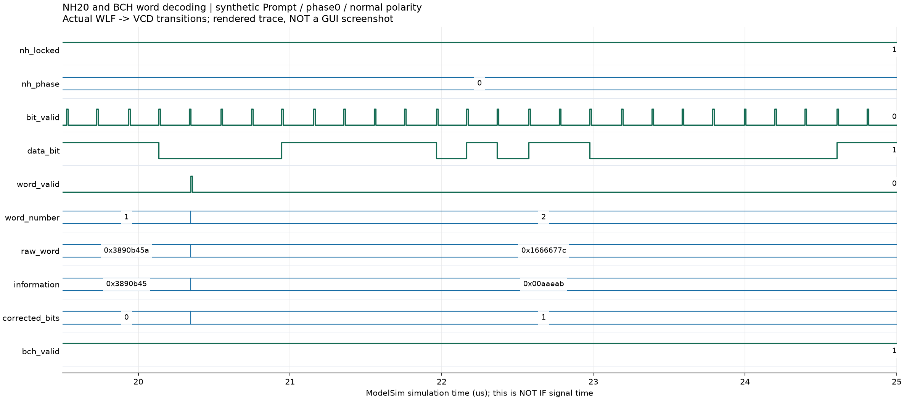
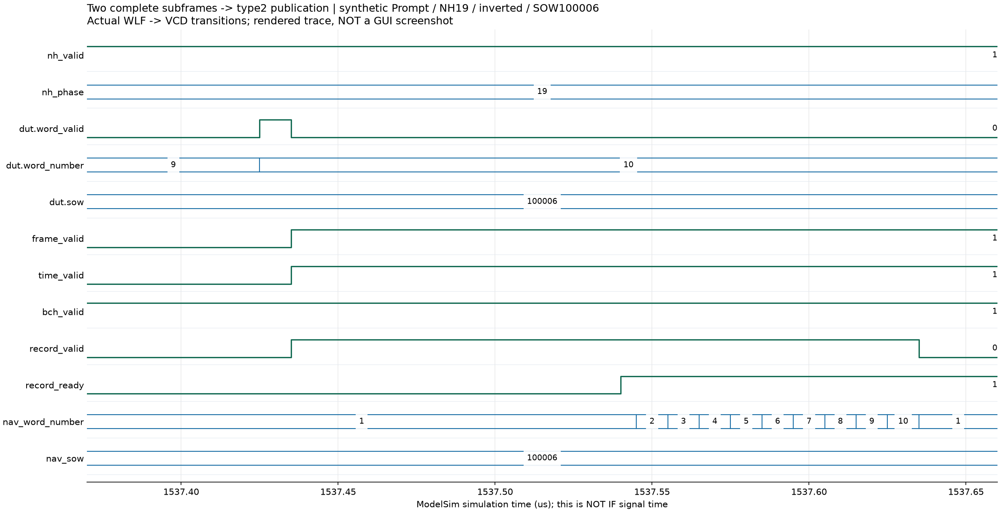

# 北斗 B1I NH、位同步与 D1 导航电文解调实验报告

提交日期：2026 年 10 月 25 日。修订日期：2026 年 10 月 14 日。

依据已核对的GitHub main `7dfa40b`与当前RTL，链路已从真实IF的实际Prompt恢复NH20、20ms数据位、D1字及导航时间，并由RTL发布type2。E历史100秒实收560字、F新实现20秒40字、G52秒240字分别独立逐字核对；早期合成Prompt九字是模块证据，软件重建仅诊断／比对，不替代RTL。

## 1. 实验目的与设计要求

从带NH调制及Costas极性模糊的1ms Prompt恢复位边界、前导码、30bit字，去交织及BCH译码，再以连续完整子帧确认SOW／导航时间，输出带实际码状态、身份及有效性的导航记录。

表 1　同步与电文参数。

| 项目 | 依据及当前实现 |
|---|---|
| 主码／Prompt | 2046chip／1ms，Fs16.368MHz；内部signed28bit Prompt I |
| NH20 | 时间顺序00000100110101001110，每chip1ms |
| 数据位 | 50bit/s／20ms，每位20个Prompt |
| 前导码 | 11100010010，同时搜索正常及反相 |
| 字／子帧 | 30bit／字，10字／子帧，6s；SFID1～5 |
| 编码 | BCH(15,11)，$g(x)=x^4+x+1$；单码字纠正1bit |
| 输出 | type2：raw／information／字号／SFID／SOW／纠错／码状态／标志 |

依据为[B1I ICD2.1](../EDA_CONTEXT_COMPRESSED/北斗_B1I_B2I_ICD_2.1版_中文版.pdf)§5.1.3／5.2.1／5.2.2、[指导书V1.7](../EDA_CONTEXT_COMPRESSED/集成电路EDA实验指导书_V1.7(1).pdf)第6／7章及教师[RECORD_FORMAT](../student_release/student_release/submission/RECORD_FORMAT.md)。RTL不输入发射位、真实NH起点或软件译码答案。

## 2. 设计思路与方案选择

分为NH／位、局部字、完整子帧／时间三层，避免一次前导码就产生可靠导航时间。

图 1　当前结构。实现：[nh20_sync](../student_release/student_release/rtl/nh20_sync.sv)、[d1_word_sync](../student_release/student_release/rtl/d1_word_sync.sv)、[navigation_d1](../student_release/student_release/rtl/navigation_d1.sv)、[receiver_channel](../student_release/student_release/rtl/receiver_channel.sv)。各槽独立同步／极性／字／子帧／时间，根输出只仲裁，不从软件补字。

A～D只有合成Prompt九字及真实跟踪Prompt恒定位；E新增封装、真实IF连接和导航时间；F扩展槽身份／代次／背压／失锁清除；G未改学生解调RTL，增加独立字评分和只消费type2／type4的因果评价。历史合成实验不能改写为当时完成IF实收。

## 3. 核心算法与 RTL 实现

### 3.1 NH20与20ms位同步

候选相位$h=0,\ldots,19$，以NH符号$a_h[k]\in\{-1,+1\}$擦除Prompt，在候选边界完成

$$
B_h[b]=\sum_{k\in b\text{的20个Prompt}}a_h[k]I_P[k],\qquad
S_h=\sum_{\text{完整训练位 }b}|B_h[b]|.
$$

tick_mod只随prompt_valid推进；训练400事件，前20事件不计残缺训练位。最高分非零且大于第二名两倍才锁定，否则清评分重新训练。400事件／两倍判据为baseline，未标定全部噪声条件。

锁定后等下一完整20ms位起点，输出signed34bit bit_soft、负值对应data_bit=1，bit_ref为首Prompt窗口ref。20项signed28bit扩位累加，评分unsigned64bit，不截短／饱和，不输出训练期半个位；整体符号反相留前导码处理。接收机由locked门控同步复位，失锁清NH／位状态；空逻辑拍不推进，但“仍锁定时Prompt丢失”尚未全覆盖。

### 3.2 前导码、极性、去交织与BCH

11bit滑动寄存器搜前导码或补码，确认极性后统一后续位，凑齐30bit字。字1前15bit不编码，后15bit单独BCH；其它字按相邻交织位分离两组15bit，分别纠错，拼22bit信息到26bit输出低位。

以$g(x)$长除法等价异或逻辑求4bit syndrome；零值保留，非零匹配15种单错syndrome并翻转，信息为修正码字前11bit。字1纠错0／1，其余两组之和0／1／2。**纠正两位只表示两个码字各错一位**，不是单码字双错纠正。

raw_word为统一极性后未经BCH修正的30bit字，information为译码信息，同时保留。bch_valid只是修正后syndrome合法，不能检测所有多错或代替真值字正确率。第10字后重搜前导码；word_valid只表示局部字，不等于完整帧／时间有效。

### 3.3 子帧、SOW与导航时间

navigation_d1缓存完整10字。字1检查前导码、BCH、SFID1～5；字2将字1information[7:0]高8bit与自身information[21:10]低12bit组成20bit SOW，要求＜604800，并回填缓存中字1的SOW。其余字累积BCH有效性。

连续两个完整合法子帧同时满足

$$
SFID_2=SFID_1\bmod5+1,\quad SOW_2=(SOW_1+6)\bmod604800,\quad
ref_2-ref_1=6F_s=98208000
$$

后才发布第二子帧十字，置frame_valid／time_valid。ref为内部子帧首位窗口参考，与输出结束锚点不同。ready/valid排空，背压保持payload；失锁清待发字和时间，重分配从新generation恢复。

Prompt→bit元数据保存最后Prompt的末端实际码相位、整周期和步长；每字取最后位元数据推导最近本地主码wrap，type2 sample_index为边界后首整数样本，code_chip=0、fraction保留真实NCO余量。该状态不是由SOW或软件答案伪造。[集成时间契约](RECEIVER_INTEGRATION.md)

### 3.4 type2与有效性

表 2　关键记录字段。

| 字段 | 位宽／含义 |
|---|---|
| PRN／channel／generation | 6／4／8bit，当前身份代次 |
| sample_index | 64bit，字结束附近本地码边界整数参考 |
| raw_word／information | 30／26bit，原始字与译码信息 |
| word_number／SFID／SOW | 4／3／20bit；字号1～10／子帧／周内秒 |
| corrected_bits | 2bit，两独立BCH码字纠错总数 |
| code_epoch／chip／fraction | 16／11／32bit；chip当前0，fraction真实余量 |
| 状态 | locked／NH／frame／time／BCH，完整确认后发布 |

type4在公共整秒真实样本、NCO更新前保存状态。active／locked／NH／frame／time／所需BCH全部满足才置measurement_valid。一个type2字不等于完整星历；收齐SF1／2／3及参数恢复属于后续软件适配责任。

## 4. 仿真环境、测试条件与结果分析

### 4.1 模块与分层测试

主证据为WSL2／Verilator5.032；本次增加ModelSim10.5模块波形，未重跑长整机。

表 3　各层实际输入与结果。

| 输入／测试 | 实测结果 | 证据及范围 |
|---|---|---|
| A～D合成Prompt，NH0／7／19，正反极性 | 111／110／110位，各3字，九字PASS，0／1／2纠错逐事件匹配 | [run](../reports/local/tb_nh_d1.run.log)、[CSV](../reports/local/nh_d1_words.csv)；无IF链 |
| A～D实际RTL Prompt 999窗 | phase1、29恒定位PASS | [run](../reports/local/tb_nh_actual_prompt.run.log)；激励无D1帧 |
| 教师decode_word独立核对 | 九字raw／信息／纠错一致，退出0 | [诊断](../reports/local/nh_d1_software_diagnostic.log)；不回写RTL |
| E双子帧导航封装 | 两NH相位／两极性／时间锚／背压／失锁PASS | [run](../reports/e_stage/final_modules/tb_navigation_d1.run.log) |
| F十二路合成Prompt | 120字／NH0-7-19／两极性／身份代次背压失锁PASS | [bank](../reports/f_stage/f3_current/tb_navigation_bank.run.log)；不是12星IF |
| 本次ModelSim轻量重复 | 九字及双子帧测试均PASS、退出0 | [九字](../reports/local/report_refresh_2026-10-14/modelsim_nh_d1.log)、[导航](../reports/local/report_refresh_2026-10-14/modelsim_tb_navigation_d1.log)；当前RTL，TB只隔离路径 |

九字激励用独立Python多项式长除法产生BCH，Prompt±100000，前40恒定位用于训练／等待。代表三字为：

| 字号 | raw hex | information hex | 纠错数 |
|---:|---|---|---:|
| 1 | 3890b45a | 3890b45 | 0 |
| 2 | 1666677c | 00aaeab | 1 |
| 3 | 0fac034e | 01f0b21 | 2 |

正反极性恢复相同字，不能将这些合成字写为公开IF实收。

### 4.2 公开真实IF的RTL恢复

教师静态六星／40dB-Hz／Fs16.368MHz／IF4.092MHz／2bit实IF，默认四槽自主捕获跟踪PRN8／11／13／21，NH/D1只由实际Prompt恢复。C++入口仅IF握手与原样32字节小端记录，教师公共文件未改。

表 5　分版本真实结果。

| 场景 | IF样本 | RTL type2字 | type4总／有效 | 教师结构／self_check | 独立字核对 |
|---|---:|---:|---:|---|---|
| E历史100s | 1636800000 | 560，每星140 | 396／324 | 均退出0／PASS | 全560字raw／信息／字号／SFID／SOW一致 |
| F新实现20s | 327360000 | 40，每星10 | 76／4 | 均退出0／PASS | 全40字一致 |
| G公开52s | 851136000 | 240，每星60 | 204／132 | 均退出0／PASS | 全240字一致 |

来源：[E报告](../reports/e_stage/final/FINAL_REPORT.md)、[E独立评分](../reports/e_stage/final/independent_score.log)、[F20评分](../reports/f_stage/real20/score.log)、[G52 NAV评分](../reports/g_stage/real52/independent_NAV.log)。墙钟分别2038.942／710.908／1492.005s，是仿真成本，不是信号或实时延迟。F/G非end与E相应前缀逐bit同，仅排除捕获周期；E100 BIN SHA256保留 `c9c4d23d1bc53bc44687a65c6473e5169fdedc0601ec71c5b1c69aa4eccdd501`，不称G新100s实跑。

独立核对从实际输出读取RTL raw_word，并用未改教师Prompt解码作对照；结果不回填BIN／DUT。它证明两实现一致，公开输入无全部发射字真值，不能直接报正式≥99%字正确率。

G RF恢复自生成测试有独立发射字真值：健康PRN7首次NAV可用后下一完整6s帧至EOF前最后完整帧，源24～36s共20预期字、缺0、信息正确20／20，Wilson95%下界83.887%。全部60发出字一致性单列，不能只统计发出字60／60替代应发字分母，也不构成正式灵敏度工作点。[G字评分边界](../reports/g_stage/FINAL_REPORT.md)

### 4.3 导航时间因果检查

E/F原Route A全文件诊断得到99／19定位历元，但自动优先软件Prompt导航，可能用后续信息解较早历元，不能证明当时RTL已有完整星历，也不是TTFF。

G只消费实际type2／type4，按输出序号及可用样本顺序重放。每PRN＋generation收齐同30s帧SF1／2／3共30字、通过BCH／健康／星历检查，SF3第10字握手后才发布完整星历，旧OBS不由未来NAV回填。52s获得49／50／51s三连解，最后必要RTL依赖时刻51.0000009775s，PDOP约9.32。[summary](../reports/g_stage/real52/causal/summary.json)、[依赖审计](../reports/g_stage/delivery_audit.json)

这是**离线因果重放**，CPU求解未调度到硬件时钟，不是持续实时PVT完成时刻，也不满足正式多次冷启／PDOP≤4的P04。51s截尾与52s延长为同输入，不是独立两试。无独立位置真值，不报精度。

### 4.4 真实RTL波形

图 2　ModelSim10.5真实WLF导出VCD后的时序图，**不是GUI截图**。当前RTL九字测试中NH已锁定、bit_valid形成20事件位，word_valid对应完整30bit字；字2纠错1，信息00aaeab。无噪声合成Prompt，横轴μs是压缩Prompt事件的TB逻辑时间，不是IF时间。信息／纠错／时间戳由TB逐事件核对。

图 3　当前navigation_d1双子帧合成测试反相用例（NH19）的实际VCD时序图。第二完整子帧末字后frame_valid／time_valid／record_valid成立，SOW100006；ready停顿保持首字，随后逐字握手。nav_word_number和nav_sow直接提取实际record_data位段，不是另造输入。TB核对十条type2全部字段及时间锚、反相和失锁清除。真实公开IF字数以表5为准，不以合成图替代。

网络中断后Computer Use运行时无法初始化，重置后仍报路径错误，未保存GUI截图；两图由真实WLF导出的实际事件绘制。原命令／退出码／源-WLF-图片哈希及窗口范围见[图像证据清单](report_assets/waveform_provenance.json)。

## 5. 问题修复、结论及当前限制

早期只用窗口首ref，集成时教师Prompt诊断按码结束解释，会错配导航锚点。现保存末积分NCO状态，type1／type2使用同一本地码结束边界和真实分数余量；十字缓存解决字1的SOW低位需由字2提供；双子帧确认防止单前导码伪有效。失锁／复用显式清NH／帧／时间，相关回归实际通过。

当前既有模块证据又有真实公开IF导航恢复，已不再是“仅九字／顶层仅end”的早期状态。全部NH相位／噪声／缺Prompt／多错组合尚未全覆盖，BCH合法不表示任意错可检；十二路Prompt不等于十二星IF。正式灵敏度／动态／位置精度未验收，G P01～P09不能写全PASS；持续实时及ASIC后端未验证。

指定相对archive路径经核对实指本仓库docs/archive；[A～D原目标](archive/GOAL_ABCD_2026-10-13_original.md)及原模块证据保持不变。当前职责见[集成文档](RECEIVER_INTEGRATION.md)及[F设计](F_MULTICHANNEL_DESIGN.md)，各结果按原版本和场景引用。
