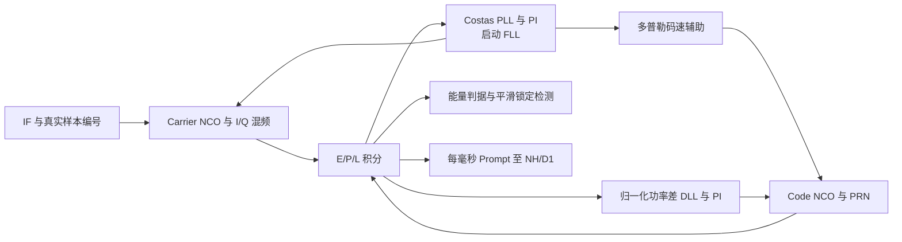

# 北斗 B1I 码与载波跟踪模块设计报告

提交日期：2026 年 10 月 18 日。修订日期：2026 年 10 月 15 日。

## 1. 实验目的与设计要求

跟踪模块以捕获结果为初值，连续调整本地码速和载波频率，使接收信号与本地参考保持同步。本实验完成了 **Code/Carrier NCO、E/P/L 相关器、DLL、Costas PLL、启动 FLL 和载波辅助码速**组成的闭环通道，并输出每毫秒的 Prompt 积分、NCO 状态和锁定状态，为 NH 同步及 D1 电文恢复提供输入。

设计重点包括：在有限位宽下实现鉴别器和环路滤波；利用 FLL 扩大启动频差的拉入范围；根据真实样本编号衔接捕获与跟踪；明确积分完成、反馈计算和控制字生效的时序。多通道结构中，各槽独立保存相位、环路历史和锁定证据，共同消费同一条带样本编号的 IF 流。

表 1　实验参数与当前通道配置。

| 项目 | 参数与实现 |
|---|---|
| 采样率、中频 | 16.368 MHz、4.092 MHz |
| 主码 | 2.046 Mcps，2046 chip/周期，8 sample/chip |
| 输入 | 教师 32 bit/16 样本握手，解包为有符号 3 bit IF |
| 积分 | E/P/L 三路 I/Q，每窗 16368 个接纳样本 |
| E/P、P/L 单边间距 | 5/16 chip，即 2.5 sample；E-L 总间距 5/8 chip |
| 环路参数 | DLL 2 Hz、PLL 15 Hz，沿用工程模型的带宽配置 |
| 启动辅助 | 前 128 个积分窗启用 FLL；运行时启用载波辅助码速 |
| 系统配置 | 默认四槽，输出教师 type1 跟踪记录及 type4 公共观测记录 |

接口遵循教师 [README](../student_release/student_release/README.md) 和 [RECORD_FORMAT](../student_release/student_release/submission/RECORD_FORMAT.md)。设计依据为[指导书 V1.7](../EDA_CONTEXT_COMPRESSED/集成电路EDA实验指导书_V1.7(1).pdf)第 4、5、7 章及 [B1I ICD 2.1](../EDA_CONTEXT_COMPRESSED/北斗_B1I_B2I_ICD_2.1版_中文版.pdf)的信号定义。

## 2. 设计思路与方案选择

### 2.1 相关前端与多环协同

前端复用已有 PRN、Code NCO 和 Carrier NCO/Mixer。输入经载波擦除后，与 Early、Prompt、Late 三组本地码相乘并积分。DLL 根据 Early/Late 功率差修正码速；Costas PLL 利用 Prompt 相位误差修正载波；启动 FLL 由相邻 Prompt 的相角变化估计残余频差；载波辅助将多普勒估计转换为码速变化。各环分别承担粗频率拉入、相位保持和细码相位调整，使接收机能够从捕获格点平滑进入稳态跟踪。

图 1　跟踪通道结构。当前 [receiver_channel](../student_release/student_release/rtl/receiver_channel.sv)实例化 [tracking_channel_minimal](../student_release/student_release/rtl/tracking_channel_minimal.sv)，并设置 `ENABLE_FLL=1`、`ENABLE_CARRIER_AID=1`；相关前端为 [tracking_frontend_spaced](../student_release/student_release/rtl/tracking_frontend_spaced.sv)。

### 2.2 捕获到跟踪的时间对齐

捕获码延迟对应历史窗口首样本，而跟踪从实际分配后的样本开始。设两者样本编号为 $n_r$、$n_e$，$\Delta n=n_e-n_r$，码相位模数为 $M=2046\times2^{32}$。启动状态按下式推进：

$$
Q_e=((16368-lag)\bmod16368)2^{29}
+\Delta n\left(2^{29}+\operatorname{trunc}(D/763)\right).
$$

其中 $D$ 是捕获多普勒控制字。$Q_e$ 对 $M$ 的商、余数给出整周期和周期内码相位；载波初相位取 $\Delta n(2^{30}+D)$ 的低 32 bit。冷启动在统一运行前预置，后台分配则预约 `processed_samples+4096`，新槽在该样本编号开始接纳。

每个接纳样本先使用当前 NCO 相位进行混频和取码，再推进相位；输入空拍保持状态。这样，PRN 预置和捕获计算使用多少逻辑拍，都能通过真实样本编号得到一致的信号相位。移交公式与[捕获报告](ACQUISITION_REPORT.md)及[集成时间契约](RECEIVER_INTEGRATION.md)保持一致。

## 3. 核心算法与 RTL 实现

### 3.1 NCO、混频与 E/P/L 积分

Code NCO 使用无符号 Q11.32 chip 相位和 Q1.32 chip/sample 步长，标称步长 `0x20000000` 对应每样本 1/8 chip，越过 2046 chip 时增加整周期计数。Carrier NCO 使用 32 bit 周相位，标称 IF 步长为 `0x40000000`，相位按 $2^{32}$ 自然回绕。查表使用 10 bit 最近地址，本振幅值为有符号 12 bit、峰值 ±2047。

混频约定为

$$
i[n]=x[n]\cos\theta[n],\qquad q[n]=-x[n]\sin\theta[n].
$$

14 bit 有符号混频结果与同拍码值进入相关器，六个积分和均为有符号 28 bit。首完整积分窗从本地码回绕后开始，每窗接纳 16368 个样本，末样本计入本窗。完整相关窗为鉴别器提供稳定的 1 ms 更新节拍。

### 3.2 DLL 与 Costas PLL

令 $P_E=I_E^2+Q_E^2$、$P_P=I_P^2+Q_P^2$、$P_L=I_L^2+Q_L^2$，单边间距 $\delta=5/16$ chip，DLL 使用归一化功率差：

$$
e_c=\frac{P_E-P_L}{P_E+P_L}\frac{1-\delta}{2}
=\frac{P_E-P_L}{P_E+P_L}\frac{11}{32}\quad(\mathrm{chip}).
$$

归一化减小输入幅度变化对鉴别增益的影响，正误差增加本地码速。Costas 相位鉴别器采用适合锁定附近的小误差近似：

$$
e_\phi\approx\frac{\operatorname{sign}(I_P)Q_P}{|I_P|+|Q_P|}\frac{1}{2\pi}
\quad(\mathrm{turn}).
$$

$1/(2\pi)$ 采用 Q16 常数 10430。NH 或数据导致 I/Q 同时反号时，鉴别结果保持一致，适合 BPSK 信号的载波相位跟踪。

两个环路均采用 PI 滤波：

$$
I[k]=I[k-1]+K_iT_ue[k],\qquad u[k]=I[k]+K_pe[k],\qquad T_u=1\ \mathrm{ms}.
$$

DLL 的 $K_p$、$K_iT_u$ 分别为 349525/65536、932/65536；PLL 对应为 40、52429/65536。输出分别以 chip/s 和 Hz 表示，积分器及输出限幅分别为 ±25 chip/s、±10 kHz。当 $P_P>4E_{input}$ 且 $P_E+P_L>8E_{input}$ 时更新环路，无效窗保持控制量。

### 3.3 启动 FLL 与载波辅助码速

真实 IF 中，捕获后的残余频差可能大于 Costas 小误差环的直接拉入范围。启动阶段取相邻有效 Prompt：

$$
dot=I_{k-1}I_k+Q_{k-1}Q_k,\qquad
cross=I_{k-1}Q_k-Q_{k-1}I_k.
$$

当 dot 为负时进行 BPSK 半周反相折叠，再用 16 次 vectoring CORDIC 求相角。相角以 turn Q16 表示，乘 1000 换为 Hz Q16，经约 0.05 的增益加入载波积分器。配对要求相邻窗能量有效、window_ref 相差 16368；无效或间断时重新建立配对。前 128 个积分窗完成频率辅助后，PLL 继续保持相位。

环路修正量转换为 NCO 字后，实际运行步长为

$$
W_{carrier}=2^{30}+D+\Delta W_{PLL/FLL},\qquad
W_{code}=2^{29}+\Delta W_{DLL}
+\operatorname{trunc}\left(\frac{D+\Delta W_{PLL/FLL}}{763}\right).
$$

763 为 B1I 射频与码率之比。载波辅助把接收机实际估计的总多普勒同时作用到码速，DLL 主要处理剩余码误差。该设计利用码、载波共同的传播频移关系，改善持续跟踪时的码相位一致性。

### 3.4 定点、锁定与反馈时序

表 2　环路主要定点处理。

| 运算或状态 | 实现 |
|---|---|
| 相关功率 | 28 bit 积分和平方为 56 bit，扩为无符号 64 bit 相加；窗能量 42 bit |
| 误差、积分器、控制量 | 有符号 32 bit Q16，单位分别为 chip、turn、chip/s、Hz |
| 归一化除法 | 有符号 80 bit 分子、正分母，向零截断；零分母时禁止更新 |
| 定点乘法与限幅 | 64 bit 中间量，算术右移 16；限幅后保存为 32 bit |
| NCO 字换算 | Q16 控制量经 64 bit 运算转换，除以采样率时向零截断 |
| Prompt 记录 | 28 bit 积分和算术右移 4，形成有符号 24 bit 输出 |

锁定检测综合 128 窗历史中的能量有效数，以及码误差、相位平方和相邻 Costas 频率变化的指数平滑值。至少 64 个能量有效窗，码均值幅度小于约 0.1 chip、相位均方小于 $0.05^2\ \mathrm{turn}^2$、频率均值幅度小于约 10 Hz 后，累计 32 个好窗进入锁定；4 个坏窗或 16 个连续无效窗退出。平滑与迟滞使锁定状态反映持续证据，并为下游同步复位提供稳定控制。

反馈采用明确的寄存器流水。若最后积分样本在拍 $t$ 接纳，则 $t+1$ 发布 window_done，$t+2$ 注册新控制字，$t+3$ 的下一接纳样本使用新字，相位累加器连续运行。连续输入 CSV 中 `feedback_ref-window_ref=16369`，新字从 feedback_ref+1 生效。

记录时间也与实际 NCO 状态衔接：type1 使用末积分状态推导最近主码结束边界后的首整数样本，code_chip 为 0，fraction 保留该点的真实余量，载波投影到同一点；type4 在公共整秒样本、NCO 更新前保存快照。多通道代次管理和释放逻辑见 [F 多通道设计](F_MULTICHANNEL_DESIGN.md)。

## 4. 仿真环境、测试条件与结果分析

### 4.1 静态闭环、间距修正与 FLL 拉入

闭环实验采用 WSL2 Ubuntu、Verilator 5.032 及独立 Python 参考模型。A～D 静态测试每例 1 s，激励为无噪声 PRN6、实余弦载波、2 bit ADC 和 NH20 翻转；初始码差 ±0.25 chip、载波相差 ±0.04 turn、频差 ±5 Hz，关闭 FLL 和码速辅助。最后 0.2 s 逐样本评分，门限为码 RMS≤0.10 chip、相位 RMS≤0.02 turn、频率 RMS≤1 Hz、尾段锁定率≥0.95。

早期间距采用单边 2 sample，在 8 sample/chip 的矩形码采样下，鉴别零区间偏在 [0,1) sample，负初差用例码 RMS 为 0.125094 chip。改为单边 2.5 sample、鉴别标度 11/32 后，零区间约对称于 ±0.5 sample，正负两种初差均满足门限。锁定检测同时采用平滑误差和迟滞，形成与稳态误差一致的锁定判断。[间距修正前记录](../reports/local/tracking_lock_fixed_code_fail.log)

E 阶段 FLL 定向测试保留 ±0.25 chip 初码差，将相位和频差扩大到 ±0.13 turn、±125 Hz，启用 FLL、关闭码速辅助。评分仍取最后 0.2 s。

表 3　静态闭环与 FLL 拉入测试结果。

| 测试 | 码 RMS/chip | 相位 RMS/turn | 频率 RMS/Hz | 尾段锁定率 | 结果 |
|---|---:|---:|---:|---:|---|
| A～D 正初差 | 0.062345 | 0.002678 | 0.847095 | 1.000000 | PASS |
| A～D 负初差 | 0.063487 | 0.002674 | 0.847133 | 1.000000 | PASS |
| E FLL，+0.13 turn、+125 Hz | 0.062426 | 0.000230 | 0.461052 | 1.000000 | PASS |
| E FLL，−0.13 turn、−125 Hz | 0.063825 | 0.000196 | 0.460938 | 1.000000 | PASS |

来源：[静态运行日志](../reports/local/tb_tracking_minimal.run.log)、[静态指标](../reports/local/tracking_metrics.json)、[FLL 运行日志](../reports/e_stage/e1_fll/tb_tracking_pull.run.log)。A～D 每例有 999 次反馈，控制字分别变化 998、999 次；前端另通过 90000 事件、4 个完整窗的[逐事件测试](../reports/local/tb_tracking_frontend.run.log)。正负初差结果接近，表明鉴别器符号、环路增益和限幅处理在两侧均能建立稳定闭环。

图 2　A～D 两例实际 `tracking_loop.csv` 的误差与 Prompt 曲线。结合尾段统计，正负初差最终分别达到约 0.062、0.063 chip 码 RMS，频率 RMS 均约 0.847 Hz。Prompt 保留 NH 符号变化供下游解调，而 Costas 鉴别器通过极性不变的形式维持载波反馈。图中参考值来自独立激励模型，用于呈现闭环估计误差。

### 4.2 积分完成与控制字更新波形

图 3 取自 ModelSim 10.5 对当前源码运行的 `tb_tracking_minimal`，配置为正初差、FLL=0、码速辅助=0。局部取证运行到 TB 30000 μs，得到 182 次反馈，实际信号约 0.183 s；该图选取启动阶段的一个积分窗。[取证日志](../reports/local/report_refresh_2026-10-14/modelsim_tb_tracking_minimal.log)

图 3　真实 WLF 导出 VCD 后绘制的局部时序，横轴为 100 MHz TB 的逻辑时间。本窗 Prompt I/Q 为 51708188/−3114158，Early I、Late I 分别为 38576068、39345938，相关器为相位和码误差计算提供了同一窗口的输入。window_done 给出相关结果，下一拍 feedback_valid 发布反馈，载波控制字由 `0x400005b0` 调整为 `0x40000577`，本窗码控制字保持。反馈 ref 与窗口首 ref 相差 16369，和前述流水关系一致。图中 locked 为 0，反映此时仍在启动和积累锁定证据；完整闭环的稳态结果见表 3。两幅图的来源、窗口及文件哈希见[图像证据清单](report_assets/waveform_provenance.json)。

### 4.3 公开 IF 的四星跟踪

教师公开场景为静态接收机、六颗 D1 卫星、40 dB-Hz，传播时延及多普勒随卫星运动变化。默认四槽自主捕获 PRN8、11、13、21，通道启用 FLL 和载波辅助码速。公开首星的粗频偏约 500 Hz，独立诊断估频约 581 Hz；原 PLL 在该残差下未能锁定，加入启动 FLL 后成功拉入，并持续产生供导航解调使用的 Prompt。

表 4　E 版本完整 100 s 的实际跟踪统计。

| PRN | Prompt 窗数 | locked 窗数 | 最后 200 窗锁定率 |
|---:|---:|---:|---:|
| 8 | 99995 | 99720 | 1.000000 |
| 11 | 99995 | 99783 | 1.000000 |
| 13 | 99995 | 99788 | 1.000000 |
| 21 | 99995 | 99768 | 1.000000 |

来源：[E 实测指标](../reports/e_stage/final/metrics.json)。四星均在尾段保持锁定，支持了 560 条 RTL 导航字和 324 条有效公共观测的恢复。F 多通道版本的 20 s 回归每星输出 19995 个 Prompt；G 的 52 s 运行每星输出 51995 个 Prompt，尾 200 窗锁定率均为 1.0，恢复 240 条导航字、132 条有效观测。教师检查及独立导航核对通过，F/G 非 end 记录与 E 对应输入前缀逐 bit 一致，比较排除捕获周期字段。[E 报告](../reports/e_stage/final/FINAL_REPORT.md)、[F 报告](../reports/f_stage/FINAL_REPORT.md)、[G 独立评分](../reports/g_stage/real52/independent_NAV.log)

### 4.4 信号强度、动态与恢复实验

G 阶段单环路保持测试先用 50 dB-Hz 信号建立 2 s，再对完整 60 s 评分。码误差覆盖全部 60000 个可测 NCO 状态；频率指标取每 1000 个状态的 1 s 平均频误，再计算 60 个均值的 RMS，区别于表 3 的逐样本尾段指标。

表 5　60 s 保持实验结果。

| 保持条件 | 码 RMS/chip | 1 s 均频误 RMS/Hz | 锁定率 | 连续锁定结果 |
|---|---:|---:|---:|---|
| 50 dB-Hz，seed4400 | 0.063231 | 0.002451 | 100.000% | 自生成测试 PASS |
| 40 dB-Hz，seed4390 | 0.073291 | 0.011747 | 97.262% | 未通过 |

来源：[50 dB-Hz 指标](../reports/g_stage/holding/hold_cn50.metrics.json)、[40 dB-Hz 指标](../reports/g_stage/holding/hold_cn40.metrics.json)。两档误差保持较小，信号强度降低后锁定证据出现中断，说明锁状态与数值误差需要结合分析。

40 dB-Hz 短动态实验使用 PRN6，四组种子依次为 4301～4304，先建立环路 2 s，再进入连续的分段加加速度轨迹。D01 的加加速度为 ±2 m/s³，D02、D03 包含 ±5 m/s³ 及零加加速度段；D04 采用 9990 Hz 基础频偏和 49.5 m/s 初始视线速度，检查频率边缘附近的跟踪。实际评分区间如下表，轨迹与 IF 配置见 [G tracking](../reports/g_stage/tracking)，生成关系见[激励模型](../model/g_signal_scenarios.py)。

表 6　短动态跟踪实验结果。

| 动态用例 | 评分时长/s | 码 RMS/chip | 1 s 均频误 RMS/Hz | 锁定率 | 连续锁定结果 |
|---|---:|---:|---:|---:|---|
| D01 | 3 | 0.055519 | 0.025147 | 96.633% | 未通过 |
| D02 | 6 | 0.039471 | 0.050916 | 42.400% | 未通过 |
| D03 | 5 | 0.033256 | 0.070388 | 83.060% | 未通过 |
| D04 | 4 | 0.008773 | 0.026892 | 96.825% | 未通过 |

整机恢复实验则采用无噪声双星自生成 IF，将 PRN6 在 20～22 s 关闭，样本流保持连续。接收机在 16 ms 内检测失锁并重新搜索；PRN7 在这 2000 个积分窗中保持 100% 锁定。PRN6 经候选复核和重试，在 generation3 于 23.093001 s 首次恢复锁定，36.000001 s 恢复 NAV 和有效 OBS。该时间差对应下游 NH 训练与连续子帧确认的恢复过程，体现了跟踪、同步和导航有效性的分层建立。[恢复指标](../reports/g_stage/recovery/recovery_metrics.json)

## 5. 实验结论

本实验实现了由 E/P/L 相关、DLL、Costas PLL、启动 FLL 及载波辅助组成的码载波闭环。E/L 间距修正解决了离散采样带来的鉴别零区间偏置，FLL 解决了公开 IF 捕获残余频差的启动拉入问题；样本编号、NCO 状态和反馈流水的统一定义，使环路更新及导航时间标签具有明确的物理含义。

静态正负初差和 ±125 Hz 拉入测试均通过，公开 IF 的四星持续跟踪进一步支撑了实际 RTL 导航恢复。多通道恢复实验中，健康槽持续工作、失锁槽独立重新建立锁定，验证了通道状态隔离和闭环恢复流程。

当前改进重点是弱信号及动态条件下的连续锁定稳定性：40 dB-Hz 保持和短动态用例仍出现锁状态中断。后续应结合能量有效率、鉴别误差和锁定平滑参数分析这些中断，并扩展相应场景验证。
