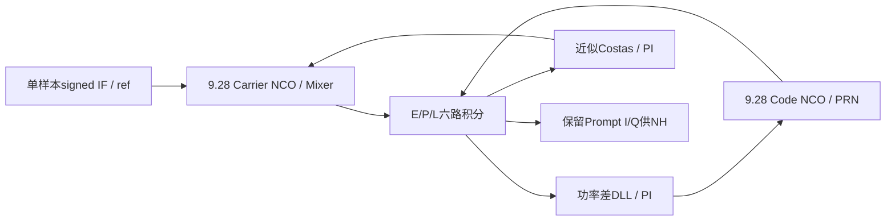
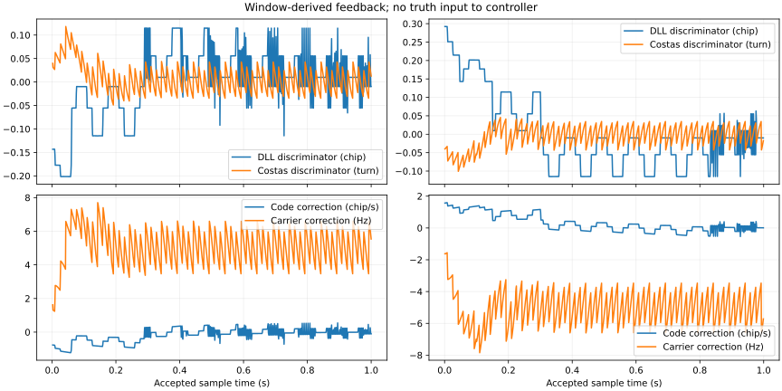

# 跟踪模块设计报告（2026-10-18交付稿）

2026-10-13本机Verilator已实际验证9.28前端，以及新增单通道DLL/Costas PLL闭环。最终两组1 s合成IF、正负初误差和ICD NH20翻转均通过预设评分；证据与失败保留。本稿覆盖最低单通道静态功能，不代表教师六星输入、多通道或完整接收机验收。

## 结构与基线

新增`tracking_channel_minimal.sv`只接收初值和IF/ref，运行时反馈只来自E/P/L与测得的能量。旧root RTL和学生目录原样副本不改。`tracking_frontend_spaced.sv`由9.28 frontend复制，只新增E/L参数透传并改模块名；原数据、时间与流水逻辑保留。捕获模块和原前端仍使用原0.25chip间隔；新闭环实例使用5/16chip，原因与失败记录见下文。

init配置PRN、Q11.32码初相和signed Doppler FCW。sample_ready在预置结束且非init时置1；未初始化不消费。两个NCO对同一接纳事件推进，注册I/Q与码延迟一拍，末样本计入积分窗。第一窗从本地码回绕后开始，依据本地状态，未输入真实NH/位边界。

## 鉴别器、环路与定点

PE=IE²+QE²，PP=IP²+QP²，PL=IL²+QL²。DLL误差`e_c=(PE−PL)/(PE+PL)×(1−δ)/2`，单位chip；本实例δ=5/16chip，系数11/32。正误差增加本地码速。载波符号沿用I=x·cosθ、Q=−x·sinθ；近似Costas误差`e_phi=sign(IP)·QP/(|IP|+|QP|)/(2π)`，单位turn，同时翻转I/Q不改变误差。

Costas采用小误差有理近似以省去atan/CORDIC，1/(2π)用Q16常数10430。它在大初相/频差下不等价于精确atan2；本次只验证±0.04turn/±5Hz初差，未实现FLL或声明±100/250Hz拉入。

PI：I[k]=I[k−1]+Ki·Tu·e[k]，u[k]=I[k]+Kp·e[k]，Tu=1ms。由旧模型Bn/zeta公式直接取DLL2Hz、PLL15Hz，不做新增带宽扫描。DLL控制为标称码速+u_c；PLL控制为捕获频偏字+u_phi换算字，NCO相位连续。

| 量 | 格式与处理 |
|---|---|
| IF / Mixer / 相关 | signed3 / signed14 / signed28 bit，保留9.28完整乘加 |
| Code phase / step | unsigned Q11.32 / Q1.32，2046chip回绕 |
| Carrier phase / step | 32bit周相位，控制字单位turn/sample，自然回绕 |
| E/P/L功率 | 完整56bit平方，扩为unsigned64bit相加 |
| DLL/PLL误差、积分、修正量 | signed32bit Q16，chip/turn/chip/s/Hz分别标明 |
| DLL Kp / KiTu | 349525 / 932（Q16），对应5.3333/s、0.0142222/s |
| PLL Kp / KiTu | 40（整数）/52429（Q16），对应40/s、0.8/s |
| 归一化除法 | 80bit signed分子，正分母；除法向零截断，零分母给0并用能量有效性屏蔽更新 |
| 定点乘法缩位 | signed64bit中间量，算术右移16（负数向下取整）；不依赖隐式无符号转换 |
| 限幅 | DLL积分/输出±25chip/s；PLL积分/输出±10kHz，先64bit限幅再存32bit |
| FCW换算 | Q16修正量×65536/Fs，signed64除法向零截断，最后显式位宽转换 |

usable条件PP>4Einput且PE+PL>8Einput。无效窗冻结控制字、清相邻相位历史。质量复用旧模型政策：128窗有效历史至少64有效；EMA码误差/相位平方α≈0.02，相邻Costas误差差分的频率均值α≈0.05；码均值<0.1chip、相位均方<0.05²turn、频率均值<10Hz，32好窗进入、4坏窗退出、16连续无效退出。当前合并成一个locked，未实现全部系统分层状态，也未验证噪声/失锁场景。

## 反馈时序与观察量

末输入样本n被接受后，n+1拍前端发布window_done，n+2拍控制器读取稳定的六路和并注册新字，下一接纳样本n+3使用新字。更新同拍样本仍用旧字，没有初始化载波相位来代替反馈。

当前连续流CSV逐窗实查`feedback_ref−window_ref=16369`；N=16368，末样本ref=window_ref+16367，新控制字从feedback_ref+1生效，即末样本后第3点。CSV的NCO相位/整周期状态对应feedback_ref+1。逻辑空拍不增加样本时间；本次闭环评分未覆盖中途缺样/重装，不能从连续流外推这些条件。

CSV包含Prompt/E/L、错误Q16、两种控制字和修正量、NCO相位/码周期、能量、locked。图由实际CSV生成，真值只用于绘图/评分，未回送DUT。

## 实际验证

根目录PowerShell：`.\scripts\run_local_verilator.ps1 -Task frontend`与`-Task tracking`。原前端：`FRONTEND_RELOAD_RESET_PASS`、`FRONTEND_REGRESSION_PASS events=90000 windows=4`，退出0。它只验证前端，不证明闭环。

闭环TB用独立PRN参考、float实余弦、ADC门限−1/0/+1产生−3/−1/+1/+3，调制ICD NH20；没有噪声或码速动态，PRN6，每例16368000样本（信号1s）。逻辑TB时钟100MHz只是功能运行节拍，Fs仍16.368MHz，不是产品时钟验收。评分取最后0.2s的3273600个接纳样本；判据预先为码RMS≤0.10chip、载波RMS≤0.02turn、频率RMS≤1Hz、锁定占比≥0.95，并检查至少995次真实反馈与控制字变化。

| 最终用例 | 初始码差/相位/频差 | 码RMS chip | 相位RMS turn | 频率RMS Hz | 尾锁定 |
|---|---|---:|---:|---:|---:|
| 0 | +0.25chip / +0.04turn / +5Hz |0.062345|0.002678|0.847095|1.000000|
| 1 | −0.25chip / −0.04turn / −5Hz |0.063487|0.002674|0.847133|1.000000|

实际`TRACKING_MINIMAL_PASS cases=2 seconds_per_case=1 NH20_flips=1`，仿真退出0，两例各999窗反馈；控制字变化998/999次。最终完整命令/源码与日志见`reports/local/tb_tracking_minimal.build.log`、`.run.log`；逐窗CSV `tracking_loop.csv`（1998行），RMS为逐样本评分，不能用窗口快照重新冒充同一指标。图/JSON生成命令：bundled Python `model/make_delivery_artifacts.py`。

## 失败与定向修复

1. 首轮瞬时误差连续32窗的锁定逻辑过敏，case0数值误差通过但锁定率0，实际FAIL。按9.28 quality_model复用EMA/证据/迟滞，外部评分不变；失败见tracking_initial_fail.log/csv。
2. 第二轮case0通过，case1码RMS0.125094>0.10，实际FAIL，见tracking_lock_fixed_code_fail.log/csv。积分控制字积分和采样几何表明：8点/chip、δ=2样本的矩形码功率差在[0,1)sample呈零误差区，PI从负侧进入后漂至+1sample附近。不是载波失败，也不能改RMS门限解决。
3. 只把新闭环E/L间隔设为2.5sample（5/16chip），将零区间居中为约±0.5sample；对应鉴别标度改为11/32。旧RTL不改、不做参数扫描。初次多层defparam编译被Verilator拒绝（保留tracking_defparam_build_fail.log），最终只新增旧前端参数透传派生文件，用正常实例参数。两原用例按原门限重新实际通过。

## 未覆盖与交付边界

未跑教师40dB-Hz多星、动态、较大残余频差、FLL切换、噪声统计、失锁恢复、捕获移交和100s。顶层尚未接此模块，也未生成真实tracking/navigation/common_observation记录；完整教师self_check仍FAIL。当前交付是可运行单通道静态模块/报告，不能当作全接收机或定位成功。

来源：9.28 model/tracking_reference.py、quality_model.py和现有模块；指导书V1.7第4/5章；ICD2.1第5.2.1节NH20；当前实际Verilator日志。冻结plan.md保持原样，本Markdown尚未排成Word/PDF。
