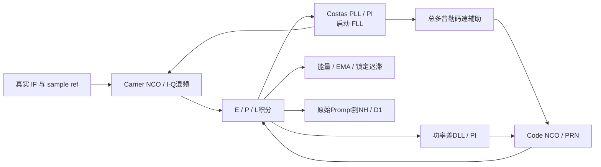
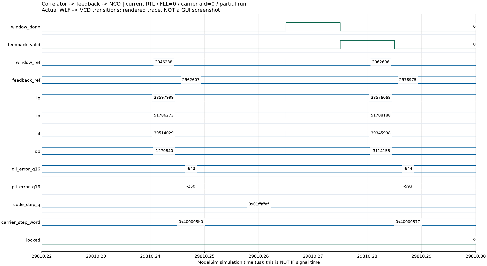
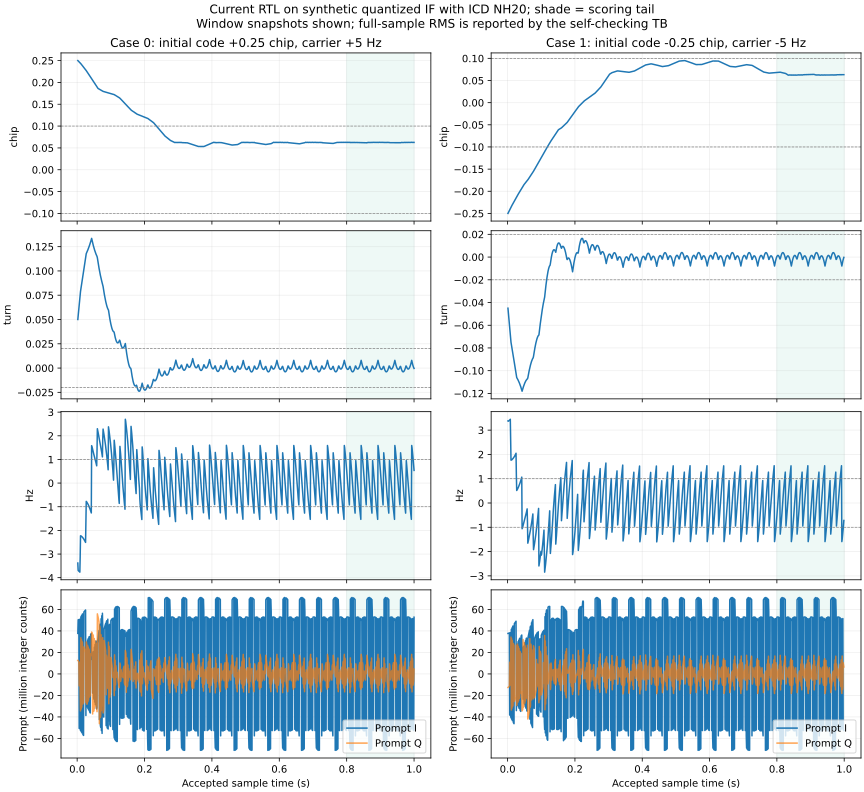

# 北斗 B1I 码与载波跟踪模块设计报告

提交日期：2026 年 10 月 18 日。修订日期：2026 年 10 月 14 日。

依据已核对的 GitHub main `7dfa40b`、当前RTL及E/F/G证据，实际通道包含 **Code/Carrier NCO、E/P/L、DLL、Costas PLL、启动FLL和载波辅助码速**。E历史公开100秒四星跟踪、F新多通道20秒回归和G52秒采集分别陈述；G独立噪声／动态测试的连续锁定FAIL不由历史公开场景PASS覆盖。

## 1. 实验目的与设计要求

以捕获PRN、码延迟和频偏为初值，通过相关输出闭环跟踪，连续估计本地码相位与载波状态，向NH/D1提供未经硬判决的1ms Prompt。每槽保存独立相位、滤波历史、锁定证据和身份，运行槽消费同一个公共真实样本。

表 1　当前跟踪参数。

| 项目 | 当前实现 |
|---|---|
| 输入参数 | Fs16.368MHz／IF4.092MHz；2.046Mcps；2046chip／1ms |
| 输入接口 | 教师32bit／16样本握手，解包为signed3bit与真实样本编号 |
| 积分 | 六路E/P/L I/Q，每窗16368个完整接纳样本 |
| 单边E/P、P/L间距 | 5／16chip＝2.5sample；E-L总间距5／8chip |
| 环路参数 | 既有模型DLL2Hz、PLL15Hz baseline，不是教师固定参数 |
| 通道配置 | 默认4；支持1／2／4／12槽；十二星完整D1动态未验收 |
| 输出 | Prompt／NCO／锁定证据；封装为教师type1／type4 |

接口以教师 [README](../student_release/student_release/README.md) 和 [RECORD_FORMAT](../student_release/student_release/submission/RECORD_FORMAT.md) 为准。纯仿真不要求学生SRAM控制器；Fs、逻辑clk及主机墙钟分开计量。

## 2. 设计思路与方案选择

### 2.1 前端复用与闭环扩展

复用9月28日PRN、Code NCO、Carrier NCO/Mixer及相关前端。A～D新增小误差DLL／Costas PI；E为真实捕获残余频差新增启动FLL及码速辅助。当前 `receiver_channel` 实例化 `tracking_channel_minimal` 时设置 `ENABLE_FLL=1`、`ENABLE_CARRIER_AID=1`，文件名minimal不代表仍是无FLL的旧闭环。

图 1　当前结构。实现：[tracking_channel_minimal](../student_release/student_release/rtl/tracking_channel_minimal.sv)、[tracking_frontend_spaced](../student_release/student_release/rtl/tracking_frontend_spaced.sv)、[receiver_channel](../student_release/student_release/rtl/receiver_channel.sv)。

F将后台捕获、失锁释放及通道复用置于通道外部。分配携带PRN／generation／生效样本；释放清NCO、环路、同步及未承诺缓存，已承诺背压记录先保持排空，避免旧代数据混入新代。[F设计](F_MULTICHANNEL_DESIGN.md)

### 2.2 捕获参考与首跟踪样本

捕获lag对应历史窗参考，不能直接作为计算完成时的相位。设捕获首样本$n_r$、首跟踪样本$n_e$，$\Delta n=n_e-n_r$，$M=2046\times2^{32}$，当前初始化为

$$
Q_e=((16368-lag)\bmod16368)2^{29}+\Delta n\left(2^{29}+\operatorname{trunc}(D/763)\right).
$$

商／余数分别给整周期／码相位；载波取$\Delta n(2^{30}+D)$低32bit。冷启动统一RUN前预置，后台预约 `processed_samples+4096`，健康槽继续运行，新槽到预约点才消费。

NCO每个接纳样本先用当前相位，再推进；空拍不增信号时间。PRN预置消耗逻辑拍，不代表收到IF，所以捕获计算拍和墙钟不进入样本差。该契约与[捕获报告](ACQUISITION_REPORT.md)一致。

## 3. 核心算法与 RTL 实现

### 3.1 NCO、混频与积分

Code NCO为unsigned Q11.32 chip相位／Q1.32 chip/sample步长，标称 `0x20000000`＝1／8chip/sample，跨2046chip增整周期。Carrier NCO为32bit周相位，IF步长 `0x40000000`，自然模$2^{32}$回绕；10bit最近地址、signed12bit本振幅值±2047。混频符号为

$$
i[n]=x[n]\cos\theta[n],\qquad q[n]=-x[n]\sin\theta[n].
$$

signed14bit混频乘积与延迟同拍的码值进入E/P/L，各signed28bit累加；末样本计入当前窗，首完整窗从本地码回绕后开始。每窗严格16368个接纳样本，不能用记录标签的取整差判断丢窗。

### 3.2 DLL、PLL、FLL与码速辅助

令$P_E=I_E^2+Q_E^2$、$P_P=I_P^2+Q_P^2$、$P_L=I_L^2+Q_L^2$，$\delta=5/16$chip，DLL为

$$
e_c=\frac{P_E-P_L}{P_E+P_L}\frac{1-\delta}{2}
=\frac{P_E-P_L}{P_E+P_L}\frac{11}{32}\quad(\mathrm{chip}).
$$

正误差增加本地码速。Costas小误差近似为

$$
e_\phi\approx\frac{\operatorname{sign}(I_P)Q_P}{|I_P|+|Q_P|}\frac1{2\pi}\quad(\mathrm{turn}),
$$

$1/(2\pi)$使用Q16常数10430，I/Q同时翻转不改误差。它不等价于全范围atan2，因此用FLL先缩小残余频差。

启动前128个积分窗，相邻Prompt的

$$
dot=I_{k-1}I_k+Q_{k-1}Q_k,\qquad cross=I_{k-1}Q_k-Q_{k-1}I_k
$$

经BPSK半周反相折叠、16次vectoring CORDIC求相角；turn Q16乘1000得到Hz Q16，以约0.05增益加入载波积分器。只有相邻能量有效且window_ref差16368才采用差分；无效或间断不能参与。该模式是启动辅助，不是任意大频差的持续FLL。

PI为$I[k]=I[k-1]+K_iT_ue[k]$、$u[k]=I[k]+K_pe[k]$，$T_u=1$ms。DLL系数349525／65536、932／65536，PLL系数40、52429／65536；输出单位分别chip/s和Hz。积分及输出限幅±25chip/s／±10kHz；有效条件$P_P>4E_{input}$且$P_E+P_L>8E_{input}$，无效窗冻结更新。

Q16控制量经signed64bit换算、除以Fs向零截断。实际运行字为

$$
W_{carrier}=2^{30}+D+\Delta W_{PLL/FLL},\qquad
W_{code}=2^{29}+\Delta W_{DLL}+\operatorname{trunc}\left(\frac{D+\Delta W_{PLL/FLL}}{763}\right).
$$

763为B1I RF／码率，辅助跟随实际总多普勒估计，未读取信号真值码速。

### 3.3 定点与锁定

表 2　数值处理。

| 量 | 格式与处理 |
|---|---|
| 相关／功率／能量 | signed28和；signed56平方，扩unsigned64相加；窗能量42bit |
| 误差／积分／控制 | signed32 Q16，分别chip／turn／chip/s／Hz |
| 归一化除法 | signed80分子、正分母，向零截断；零分母给0并禁止有效更新 |
| 定点乘法 | signed64中间量，算术右移16，负数按算术移位取整 |
| 限幅与相位 | 64bit限幅后存32bit；NCO周相位回绕 |
| Prompt记录 | signed28算术右移4至signed24，单位为原积分和的1／16 |

锁定使用128窗历史、至少64能量有效窗，以及码误差／相位平方／相邻Costas频变化EMA。码均值约±0.1chip、相位均方＜$0.05^2$turn²、频率均值约±10Hz；32好窗进入、4坏窗退出、16连续无效窗退出。`locked`不等于NH／帧／时间全有效，导航条件不足时type4仍无效。

### 3.4 反馈生效和记录时间

最后积分样本在拍t接纳，t+1前端发布window_done，t+2注册误差和新控制字，t+3下一接纳样本用新字；更新同拍仍用旧字，载波相位连续。连续流历史CSV实查 `feedback_ref-window_ref=16369`，从feedback_ref+1生效；有空拍须按真实接纳事件解释。

内部window_ref为积分首样本；教师type1／type2标签为末积分NCO状态推导的最近主码结束边界后的首整数样本。code_chip=0、fraction保留该点真实余量，载波推进或回退到同一点。type1 schema3由bit23及bits31:30识别，generation低6bit；标签间隔可因码速／取整差约±2sample，真实积分未缺样。type4在公共整秒样本、NCO更新前保存状态。[时间契约](RECEIVER_INTEGRATION.md)

## 4. 仿真环境、测试条件与结果分析

### 4.1 静态闭环与FLL

A～D每例1s，无噪声PRN6、独立实余弦／2bit ADC／NH20翻转；初码差±0.25chip、相位±0.04turn、频差±5Hz。最后0.2s逐样本评分，预设门限码≤0.10chip、相位≤0.02turn、频率≤1Hz、尾锁定≥0.95。

表 3　历史模块实测，均由WSL2／Verilator5.032运行。

| 测试 | 码RMS chip | 相位RMS turn | 频率RMS Hz | 尾锁定 | 结果 |
|---|---:|---:|---:|---:|---|
| A～D正初差 | 0.062345 | 0.002678 | 0.847095 | 1.000000 | 静态PASS |
| A～D负初差 | 0.063487 | 0.002674 | 0.847133 | 1.000000 | 静态PASS |
| E FLL +0.13turn／+125Hz | 0.062426 | 0.000230 | 0.461052 | 1.000000 | FLL定向PASS |
| E FLL −0.13turn／−125Hz | 0.063825 | 0.000196 | 0.460938 | 1.000000 | FLL定向PASS |

来源：[原闭环run](../reports/local/tb_tracking_minimal.run.log)、[metrics](../reports/local/tracking_metrics.json)、[FLL run](../reports/e_stage/e1_fll/tb_tracking_pull.run.log)。A～D每例999次反馈，控制字变化998／999次；E FLL测试未启用码速辅助。前端90000事件／4窗PASS仅证明数据与时序，不能单独证明闭环。[前端日志](../reports/local/tb_tracking_frontend.run.log)

E公开首星粗频约500Hz，与实际输出独立估频约581Hz相差约81Hz，原PLL实跑无锁，增加FLL后拉入；软件诊断答案未回送DUT。E100秒结果如下。

| E100历史PRN | Prompt数 | locked数 | 尾200窗锁比例 |
|---:|---:|---:|---:|
| 8 | 99995 | 99720 | 1.000000 |
| 11 | 99995 | 99783 | 1.000000 |
| 13 | 99995 | 99788 | 1.000000 |
| 21 | 99995 | 99768 | 1.000000 |

来源：[E metrics](../reports/e_stage/final/metrics.json)。F新实现20s教师检查／独立NAV通过；G52每星51995 Prompt、尾锁1.0，240 NAV／132有效OBS，self_check退出0。F/G非end与E相应前缀逐bit同，仅排除捕获周期；不是F/G新100秒回归。[F报告](../reports/f_stage/FINAL_REPORT.md)、[G独立评分](../reports/g_stage/real52/independent_NAV.log)

### 4.2 G弱信号与动态

单环路自生成IF先50dB-Hz建立2s，再评分完整60s；误差包括所有可测1ms NCO状态，不能只选usable／locked窗。频率指标先对完整1000点／1s频误求均值再取RMS，与上节逐样本尾频RMS不同。

| 条件 | 码RMS chip | 1s均频误RMS Hz | 锁定比例 | 分类 |
|---|---:|---:|---:|---|
| 50档／seed4400／60s | 0.063231 | 0.002451 | 100.000% | SELF_GENERATED_PASS，单环路保持 |
| 40档／seed4390／60s | 0.073291 | 0.011747 | 97.262% | 连续锁FAIL，数值合格 |

来源：[50 metrics](../reports/g_stage/holding/hold_cn50.metrics.json)、[40 metrics](../reports/g_stage/holding/hold_cn40.metrics.json)。各60000状态／60完整均频窗，无manager／D1／OBS／几何，不能外推整机灵敏度。

| G40短动态 | 评分s | 码RMS chip | 1s均频误RMS Hz | 锁定比例 | 结论 |
|---|---:|---:|---:|---:|---|
| D01 | 3 | 0.055519 | 0.025147 | 96.633% | 连续锁FAIL |
| D02 | 6 | 0.039471 | 0.050916 | 42.400% | 连续锁FAIL |
| D03 | 5 | 0.033256 | 0.070388 | 83.060% | 连续锁FAIL |
| D04 | 4 | 0.008773 | 0.026892 | 96.825% | 连续锁FAIL |

来源：[G tracking](../reports/g_stage/tracking)。完整轨迹数学自测与短IF分开，未满足正式12有效D1／同步后≥30s的P07；数值误差合格不能覆盖锁失败。

G真实RF恢复自生成整机中，PRN6在20～22s消失但样本不暂停；16ms检测失锁，健康PRN7中断2000窗锁100%。保留错误候选和两次失锁；真正重捕generation3首锁握手23.093001s，NAV／有效OBS36.000001s。无噪声双星缩网格为SELF_GENERATED_PASS，不替代正式标称P08。[恢复metrics](../reports/g_stage/recovery/recovery_metrics.json)

### 4.3 实际波形与历史曲线

图 2　由ModelSim10.5真实WLF导出的VCD绘制，**不是GUI截图**。当前源码、原 `tb_tracking_minimal` 正初差局部窗口显示window_done后一拍feedback_valid，载波控制字由0x400005b0更新至0x40000577；此窗码控制字保持，反馈引用与窗首相差16369样本。取证为历史兼容配置FLL=0／码速辅助=0，到TB30000μs停止；182次反馈、末样本2997948、约0.183s信号，此时locked=0。它证明反馈时序，不是完整一秒回归或新的锁定性能结果。100MHz TB刻度不等于IF信号时间。[本次日志](../reports/local/report_refresh_2026-10-14/modelsim_tb_tracking_minimal.log)

图 3　A～D实际tracking_loop.csv两例静态曲线；真值仅评分／绘图，不回送控制器，也不代表G弱信号或动态。图片、源和WLF哈希见[证据清单](report_assets/waveform_provenance.json)。

ModelSim真实WLF已生成并观察，但网络中断后Computer Use运行时路径错误，重置重试仍失败，未取得可归档GUI截图；本报告采用实际记录时序图和历史CSV曲线，不把绘图冒充GUI截图。

## 5. 问题修复、结论及当前限制

初次瞬时误差判定过敏，数值合格却无锁，复用既有EMA／证据／迟滞，外部评分不变。负初差仍码RMS0.125094＞0.10：8点/chip、单边2sample时矩形码鉴别零区间偏在[0,1)sample。新封装改2.5sample、标度11／32，使零区间约±0.5sample；两原用例重跑通过，旧基础RTL保留。[初失败](../reports/local/tracking_initial_fail.log)、[间距修复前失败](../reports/local/tracking_lock_fixed_code_fail.log)

当前闭环已在公开真实IF输出可用Prompt并支撑RTL导航，有静态、FLL及独立保持证据。G40保持和短动态连续锁失败仍存在，正式P05～P07缺统一输入。十二槽数字服务不等于十二星资格，反压模型不证明持续实时。未执行ASIC后端，也无公开独立位置真值支持定位精度。

依据：[指导书V1.7](../EDA_CONTEXT_COMPRESSED/集成电路EDA实验指导书_V1.7(1).pdf)第4／5／7章、[B1I ICD2.1](../EDA_CONTEXT_COMPRESSED/北斗_B1I_B2I_ICD_2.1版_中文版.pdf)。历史范围见[A～D原目标](archive/GOAL_ABCD_2026-10-13_original.md)，分版本证据见[E](../reports/e_stage/final/FINAL_REPORT.md)／[F](../reports/f_stage/FINAL_REPORT.md)／[G](../reports/g_stage/FINAL_REPORT.md)。
