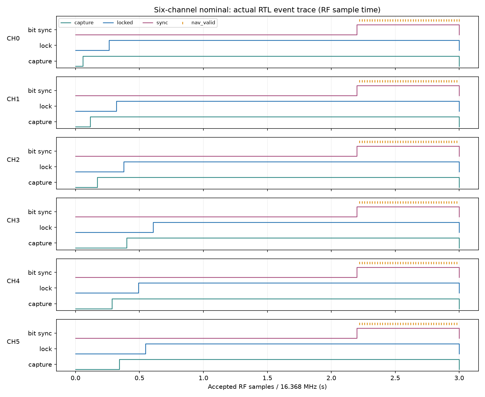
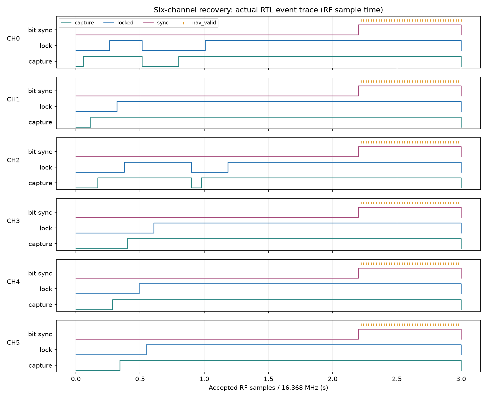

# 六通道RTL与功能仿真报告

日期：2026-11-02。Windows维护源，既有WSL Ubuntu运行Verilator 5.032；Python独立生成码、D1电文、六星混合IF及评分真值。当前成果是六通道核心RTL和功能测试，未执行TSMC28综合、PAD接入或SDF门级仿真。

## 1. 规范与实现

已读取`261102`中的六通道综合要求、VCD功耗评估说明及TSMC28学生库说明。当前接口和功能检查以新六通道要求为准；旧E/F/G报告保留其原范围。

核心为[bds_bb_6ch_core.sv](../../student_release/student_release/rtl/bds_bb_6ch_core.sv)，具有clk、rst_n、IF[1:0]、四组6位输出及必要的采样握手/逐槽PRN配置。各槽独立保存捕获、跟踪、NH、D1及控制状态；捕获计算复用公共PCPS/精搜，六路跟踪并行。详细接口、时钟与样本时间、16样本接入和NH/数据层级见[六通道设计](../../docs/SIX_CHANNEL_DESIGN.md)。

复用模块包括原参数化架构的`receiver_channel`、PCPS、精搜、码/载波NCO、DLL/FLL/PLL、NH和D1。PCPS新增配置PRN单目标模式，默认原扫描模式保持；NH/D1新增极性恢复后的串行位接口，原导航字输出保持。旧`student_receiver_core`也支持CHANNELS=6。

输入编码沿用公开包的00/01/10/11→−3/−1/+1/+3。它与另一个简化BDI源的有符号2位编码不同；本轮未混用这两种编码。Fs=16.368MHz、IF=4.092MHz、Rc=2.046Mcps，样本时间只在采样握手时推进。

## 2. 自动验证

表中PASS均有实际仿真退出0、自动内容或覆盖检查及日志，不以进程正常结束代替评分。RTL中不接入发送真值、预定码相位、频偏答案或预期电文；真值仅供信号生成和输出评分。

最终正常、PRN重排和恢复三个六星IF用例合计逐位核对705位，六路Prompt用例另核对1,080位，全部一致。各次实际接纳的捕获lag与独立源在对应capture_ref处的期望值一致，最大误差0sample。恢复用例拒绝3个不连续假峰后正确重捕。

| 测试 | 条件与检查 | 结果/证据 |
|---|---|---|
| 六星正常端到端 | PRN6～11、不同整数样本延迟、交替载波极性、相同IF混合量化；3s；独立RTL捕获/跟踪/NH/D1；逐nav_valid比对位序/通道/内容及连续位索引 | PASS，49,104,000样本，六路稳定锁定，逐位235位；[日志](receiver_run.log) |
| PRN重排端到端 | 槽0～5配置PRN7/6/11/10/9/8；以对应卫星的独立电文评分，避免默认映射掩盖配置问题 | PASS，49,104,000样本，逐位235位；[日志](permuted_run.log) |
| RF恢复及配置隔离 | 仅去掉PRN6的0.5～0.7s信号，时间连续；另在0.9s停用槽2、0.92s启用；检查捕获/锁定撤销、重捕与其余四路无额外失锁 | PASS，3s、逐位235位；PRN6/槽2各一次失锁/两次捕获，终态六路锁定；[日志](recovery_run.log)、[汇总](summary.json)；保留[初始1.4s记录](recovery_short_initial.log) |
| 定速吞吐 | 假定100MHz逻辑时钟，用相位累加器精确生成16.368MHz采样节拍，输入节拍不因ready改变；遇不能接纳立即FAIL | PASS，0.4s/6,547,200样本，40,000,140拍（含配置/复位/排空），6路同时锁定，输入反压0；[日志](paced_run.log) |
| 六路串行位分层 | 六路独立Prompt，NH相位0/3/6/9/12/15、正反极性、错时启动、空拍、失锁后再同步；按独立D1源逐位比较两轮输出 | PASS，1,080位；[最终日志](final_navigation/navigation_run.log) |
| 原通道及复用 | 1/2/4/12路共同样本逐事件断言，同PRN数值一致；未承诺/已承诺记录、失锁、代次、预约样本及复位 | PASS，196,416样本/206,440拍；[bank](legacy_channels/tb_channel_bank.run.log)、[reuse](legacy_channels/tb_channel_reuse.run.log) |
| 原导航字 | 12个独立解码器，NH相位0/7/19、极性、反压、身份/代次及失锁清理 | PASS，120字；[日志](legacy_navigation/tb_navigation_bank.run.log) |
| 原E0与尾部 | 3组独立码相位/±1000Hz接收、输入/输出反压；短尾/捕获边界/最后16样本/复位与排空 | PASS；[E0](legacy_e0/tb_receiver_e0.run.log)、[独立评分](legacy_e0/e0_score.log)、[尾部](legacy_e0/tb_receiver_tail.run.log) |
| 原PCPS/精搜 | 原默认PRN扫描模式的缩网格时延及采样接口 | PASS，65,472样本，962,024处理拍；[日志](legacy_timing/tb_p02_probe.run.log) |
| 公开IF旧六槽入口 | 原409MB公开六星文件前0.3s，CHANNELS=6、完整默认搜索网格、输入停顿及输出反压，教师结构检查 | PASS，4,910,400样本、1,481条记录，5个捕获/各295个Prompt；[运行](public_legacy6/run.log)、[教师检查](public_legacy6/structure.log) |

公开IF短窗内PRN8/11/13/21/28均产生锁定Prompt。前四星的1,184条共同记录与冻结F2结果逐位一致，仅忽略type5的硬件周期字段；[比较明细](public_legacy6/prefix_comparison.json)。这项证明旧16样本接口及共用算法的兼容性，不称公开场景六颗卫星全部恢复导航。自生成六星端到端提供本轮六路同时实收、独立配置与逐位输出的证据。

## 3. 采样吞吐与时序

新核心在冷捕获计算期间继续接收IF，捕获到跟踪按窗口参考传播码/载波相位并预约4096未来样本。验证probe断言每个运行槽在预约时刻之后都接受同一个公共样本，不能跳过或错用下一样本。汇总评分还按独立源的延迟与实际capture_ref核对每次接纳的lag，允许最多1sample（0.125chip）估计误差，而非只看最终锁定位。

最密送样的正常3s用例49,104,000样本/50,518,067拍，约1.0288拍/样本，其中每37拍一个主动输入空拍；实际反压48,577拍，最长3拍。重排结果50,518,571拍、最长3拍。它们用于反压及样本一致性压力测试，不能将其仿真逻辑时间直接作为16.368MHz信号时间。

定速用例使用10ns逻辑周期和精确16.368MHz采样节拍，0.4s连续输入无积压、无丢样，六路最终同时锁定。100MHz为功能服务测试预算，并未将它作为已实现的TSMC28目标时钟。下一阶段仍须实际库下STA和接口预算确认。

输出是去除NH副码、确认D1极性后的原始串行比特，保留BCH校验位及MSB-first位序。初始用于确认极性的首字不补发，从下一位开始。bit_sync_ok不代表两完整子帧/导航时间已确认；旧导航字时间有效性沿用原逻辑。nav_valid每新位仅持续一个clk，失锁/重配置后不发送旧积分残留。

## 4. 波形与失败记录



正常用例六路先后捕获并独立锁定，随后确认各自的位同步；图顶部短线表示每路nav_valid事件。末端全清零是显式全局复位检查。

最终根端口VCD精度1ps，C++按5000ps半周期推进；自动解析验证前20个时钟边沿间隔5000ps，以及三组IF用例705个nav_valid脉冲均恰好10000ps。稀疏记录也捕捉输出置位的NBA边沿，避免因漏记置位边沿而显示半拍脉宽。



恢复图的PRN6/槽0中断和槽2重配置只影响各自状态；其余槽继续跟踪，随后恢复同步与导航位。事件数据保存为`*_events.csv`。本机`work/six_channel_20261102/{nominal,permuted,recovery,paced}.vcd`按根端口记录复位、关键状态变化和导航位脉冲，属于稀疏诊断波形，不是完整功耗活动。

最初1.4s恢复用例只证明重捕和重新锁定；扩展到3s后曾因PRN6再次失锁而FAIL，[失败日志](recovery_extended_tail_fail.log)。诊断发现RF缺失期间的互相关假峰：窗口参考8,445,895，估计lag12,404，而真信号在该窗口对应lag16,361，相差约3,957样本。诊断[日志](recovery_diagnostic_fail.log)和本机详细CSV保留；发送真值仅用于事后分析，没有进入修复逻辑。

修复在新核心增加基于本槽最近锁定NCO的快速重捕一致性检查：把候选与内部预测传播到同一预约样本，最近2s内只接纳循环距离≤16样本的候选；状态过旧恢复全搜索，重配置清预测。该尺度是工程参数，不修改原捕获或锁定门限。它拒绝失锁后远离原轨迹的互相关峰，并在信号返回后接纳正确候选。最终恢复用例要求两处各恰好一次失锁/两次捕获、六路终态锁定、恢复后逐位电文正确，不能用再次分配代替恢复成功。

另保留两项早期环境/TB失败：导航编译入口漏加LUT include路径，[记录](navigation_build_missing_include.log)；测试台在撤销locked的同一负沿检查寄存器，发生竞争，[记录](navigation_sampling_race_fail.log)。分别补齐实际包含路径、改为正沿NBA完成后1ns检查，数据比较未放宽。绘图依赖最初缺matplotlib，仅在本机work下安装绘图依赖，不改系统或EDA环境。

## 5. 复现与交接

在工程根目录，用现有含numpy的Python运行：

```powershell
& 'C:/Users/26255/.cache/codex-runtimes/codex-primary-runtime/dependencies/python/python.exe' -X utf8 model/six_channel_vectors.py
pwsh -NoProfile -File scripts/run_six_channel.ps1 -Task all
pwsh -NoProfile -File scripts/run_f_stage.ps1 -Task timing -EvidenceDirectory reports/six_channel_20261102/legacy_timing
pwsh -NoProfile -File scripts/run_fast_verilator.ps1 -Channels 6 -DurationSeconds 0.3 -MinimumAcquisitions 4 -Backpressure -InputStalls -EvidenceDirectory reports/six_channel_20261102/public_legacy6
```

`run_six_channel.ps1`支持navigation/receiver/permuted/recovery/paced/legacy，便于只复现对应范围。完整默认公开IF搜索虽仅0.3s输入，仍需搜索32PRN和默认频率网格，本机实际约692s；无需为后续纯文档修改重复这项回归。

新核心和旧CHANNELS=6入口均通过`SYNTHESIS`定义下的Verilator展开/lint（两个`final_lint_*.log`）。复用模块的既有宽度告警保留，未见锁存、多驱动或组合不收敛告警；该检查不等同于DC综合。最终同版核心完整回归之后，C++仅修正时间刻度和稀疏波形采集边沿，重编译见`clock_units_build.log`，最终运行源哈希见`clock_units_final.sources.json`。

绘图/结果汇总：本机已将matplotlib依赖隔离在`work/six_channel_20261102/plot_deps`，将该路径设置为本次Python的PYTHONPATH后运行`model/six_channel_report.py`。源与配置哈希在各`*.sources.json`，输入/教师文件/本机波形哈希在[清单](stimulus_and_waveforms.json)，实际计数在[summary.json](summary.json)。大IF、构建、VCD和详细二进制记录保留本机，轻量日志/CSV/图片/JSON在本报告目录。

用户于2026-11-02补充授权Git提交推送，提交记录见Git历史。教师原始资料、本机IF/VCD/构建及二进制记录不随本次交付上传。后续工作为读取真实TSMC28及PAD模型、确定时钟/IO/复位与存储约束，再建立含PAD顶层，执行综合及最大/最小延迟SDF后仿。现有宽运算、组合复位和存储端口风险见[综合准备](../../docs/SYNTHESIS_READINESS.md)。Verilator功能结果不能替代这些门级时序和X/Z检查。
